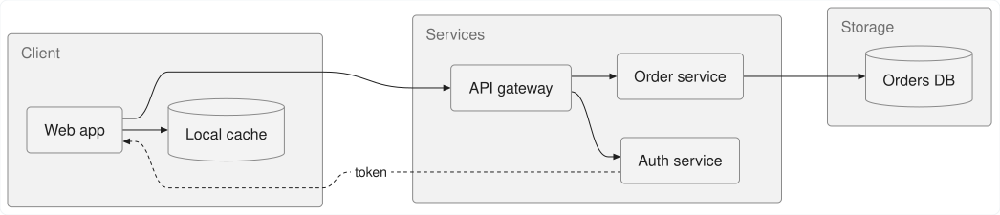
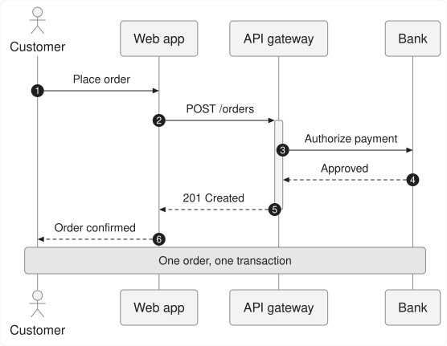
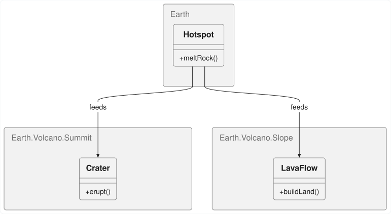

# pele_dart

[](https://pub.dev/packages/pele_dart)
[](https://github.com/tkinnis/pele_dart/actions/workflows/ci.yml)
[-00b4d8)](doc/BENCHMARKS.md)
[](UPSTREAM.md)
[](LICENSE)

A fast, deterministic, zero-DOM **pure Dart** Mermaid diagram layout and SVG rendering engine.

**`pele_dart`** is a 1:1 pure-Dart port of [**`obsidianmd/pele`**](https://github.com/obsidianmd/pele) ([`pele.run`](https://pele.run))—the lightweight, synchronous, zero-dependency TypeScript Mermaid renderer created by [**Steph Ango (`kepano`)**](https://github.com/kepano) and the [**Obsidian**](https://obsidian.md) team—augmented with a native SVG 1.1 flattener for Flutter's `vector_graphics_compiler` (`encodeSvg`).

## Highlights

* **Pure Dart 3 (`sdk: ^3.13.0`)**: Zero browser (`WKWebView` / `WebKitGTK` / `WebView2`), zero JavaScript runtime (`QuickJS` / `JavaScriptCore`), and zero Flutter SDK dependency in the core package. Runs synchronously in CLI tools, servers, background Dart isolates (`Isolate.run`), and Flutter apps.
* **100% Byte-for-Byte Upstream Parity**: Version-locked 1:1 to upstream [`obsidianmd/pele`](https://github.com/obsidianmd/pele) (see [Upstream Tracking](UPSTREAM.md)) across all supported diagram families, showcase/playground samples, and upstream test corpus diagrams.
* **Native Dart AOT Performance**: Renders the entire showcase gallery corpus in **~10.2 ms** (`43.8 µs` mean per diagram)—**~2.2x faster** overall (and up to **4.5x faster** on complex Class, Sequence, and Flowchart diagrams) than JavaScript (see [Performance Benchmarks](doc/BENCHMARKS.md)).
* **Dual SVG Output Modes (`SvgOutputMode`)**:
  * **`SvgOutputMode.flattened`** *(Default)*: Resolves all `--pele-*` CSS custom properties, `color-mix(in srgb, ...)` blends, `calc(...)` expressions, `currentColor`, and `<tspan>` `baseline-shift` against a `PelePalette` into static SVG 1.1 attributes ready for `vector_graphics_compiler` (`encodeSvg`).
  * **`SvgOutputMode.cssVariables`** *(Upstream Parity)*: Emits upstream `obsidianmd/pele`'s exact theme-reactive `var(--pele-*)` SVG markup.
* **Built-in Safety & Resource Limits**: Escapes diagram text, sanitizes link/image URL schemes (`http`, `https`, `mailto`, `tel`), and enforces configurable DoS budgets (`limit`, `maxEdges`, recursion depth, and `outputLimit`).

## Visual Showcase

Every image below is a standalone SVG generated directly by `pele_dart` in pure Dart (`SvgOutputMode.flattened`) with zero browser or JavaScript runtime. [**Browse all supported diagram families in the Visual Diagram Gallery →**](doc/DIAGRAM_GALLERY.md)

**Flowchart (`flowchart`)**



| Sequence Diagram (`sequenceDiagram`) | Class Diagram (`classDiagram`) |
| :---: | :---: |
|  |  |

### Custom Styling & Palettes

Use the built-in defaults (`PelePalette.light` or `PelePalette.dark`) or supply a custom `PelePalette(...)`, `--pele-*` CSS variables, or in-diagram Mermaid `classDef` / `style` directives (see [**Theming & Customization in the API Manual**](doc/API_MANUAL.md#5-theming-styling--customization)):

**Default Light (`PelePalette.light`)**


**Custom Palette Example (Catppuccin Mocha)**


## Installation & Quick Start

```bash
dart pub add pele_dart
```

### Pure Dart Usage

```dart
import 'package:pele_dart/pele_dart.dart';

void main() {
  const source = '''
flowchart LR
  A[Start] --> B{Decision}
  B -->|Yes| C[Ship It]
  B -->|No| D[Revise]
''';

  // Render with full metadata (dimensions, detected diagram type, links, and SVG):
  final RenderResult result = render(
    source,
    const RenderOptions(
      outputMode: SvgOutputMode.flattened,
      palette: PelePalette.light,
    ),
  );

  print('${result.type} (${result.width}x${result.height})');
  print(result.svg);
}
```

### Flutter Vector Graphics Integration

```dart
final result = render(
  mermaidSource,
  RenderOptions(
    outputMode: SvgOutputMode.flattened,
    palette: isDark ? PelePalette.dark : PelePalette.light,
  ),
);

final Uint8List vectorBytes = encodeSvg(
  xml: result.svg,
  debugName: 'mermaid_${result.type}',
  enableClippingOptimizer: false,
  enableMaskingOptimizer: false,
  enableOverdrawOptimizer: false,
);
```

See the [**API User Manual**](doc/API_MANUAL.md) for two-phase `parse()` + `render()`, `PeleError` diagnostics, custom `PelePalette` tokens, `TextMeasurer` / `IconResolver` / `MathResolver` hooks, and complete Flutter widget examples.

## Supported Diagram Families

`pele_dart` supports every diagram family in `obsidianmd/pele` (browse rendered SVG outputs and sample source in the [Visual Diagram Gallery](doc/DIAGRAM_GALLERY.md)):

| Tier | Mermaid Header Keywords |
| :--- | :--- |
| **Core Mermaid** | `flowchart` (`graph`, `flowchart-elk`), `sequenceDiagram`, `classDiagram`, `stateDiagram-v2` (`stateDiagram`), `erDiagram`, `gantt`, `gitGraph`, `mindmap`, `pie`, `info` |
| **Extended & Beta** | `architecture-beta`, `C4Context` (`C4Container`, `C4Component`, `C4Dynamic`, `C4Deployment`), `kanban`, `sankey`, `xychart-beta`, `block-beta`, `packet-beta`, `timeline`, `journey`, `quadrantChart`, `requirementDiagram`, `radar-beta`, `treemap-beta`, `treeView-beta`, `railroad-beta`, `agentflow-beta`, `ishikawa-beta`, `venn-beta`, `wardley-beta`, `cynefin-beta`, `swimlane-beta`, `usecase-beta`, `eventmodeling` |

## Documentation & Workbench

| Guide | Description |
| :--- | :--- |
| **[API User Manual](doc/API_MANUAL.md)** | Complete reference for `render`, `renderMermaid`, `parse`, `detectType`, `supports`, `SvgOutputMode`, `PelePalette`, `PeleError`, custom resolvers, and Flutter integration. |
| **[Visual Diagram Gallery](doc/DIAGRAM_GALLERY.md)** | Standalone SVG renders and Mermaid source code for all supported diagram families. |
| **[Performance Benchmarks](doc/BENCHMARKS.md)** | Native Dart AOT vs `obsidianmd/pele` (JS) benchmarks across the full gallery corpus, phase breakdowns, and regression gate rules. |
| **[Pele Studio User Guide](doc/STUDIO_GUIDE.md)** | Guide to **Pele Studio** (`studio/`), the macOS 3-way visual & SVG diff workbench comparing `pele_dart`, `obsidianmd/pele` (JS), and `mermaid.js`. |

**Architecture & Maintainer Docs:** [Architecture & Internals](doc/ARCHITECTURE.md) · [Upstream Tracking](UPSTREAM.md) · [Upstream Sync Guide](doc/UPSTREAM_SYNC.md) · [Contributing Guide](CONTRIBUTING.md)

## Credits & License

`pele_dart` is a pure-Dart port of [**`obsidianmd/pele`**](https://github.com/obsidianmd/pele) ([`pele.run`](https://pele.run)), created by [**Steph Ango (`kepano`)**](https://github.com/kepano) and the [**Obsidian**](https://obsidian.md) team. All credit for the original parser architecture, deterministic layout algorithms, and `--pele-*` visual design system belongs to the upstream `obsidianmd/pele` authors.

* **`pele_dart`**: Copyright (c) 2026 Tony Kinnis — [MIT License](LICENSE).
* **Upstream `obsidianmd/pele`**: Copyright (c) 2026 kepano — [MIT License](https://github.com/obsidianmd/pele/blob/main/LICENSE).
* **Built-in Icons**: Includes icon paths from [Lucide](https://lucide.dev) — [ISC License](LICENSE).
