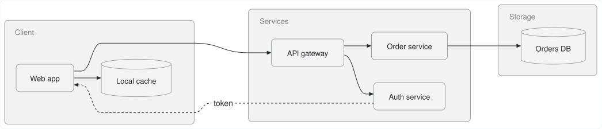
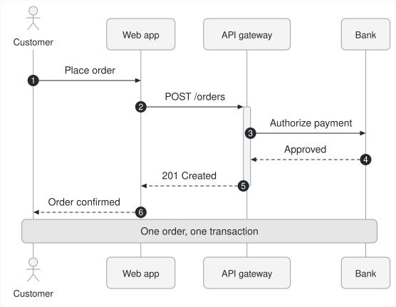
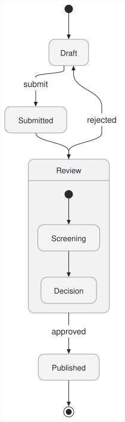
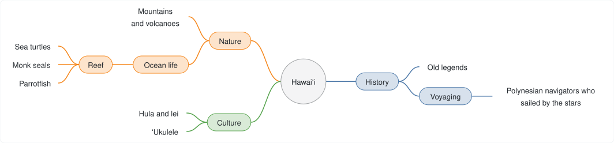
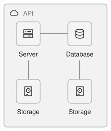
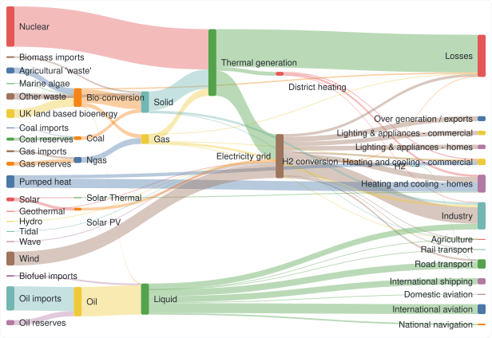
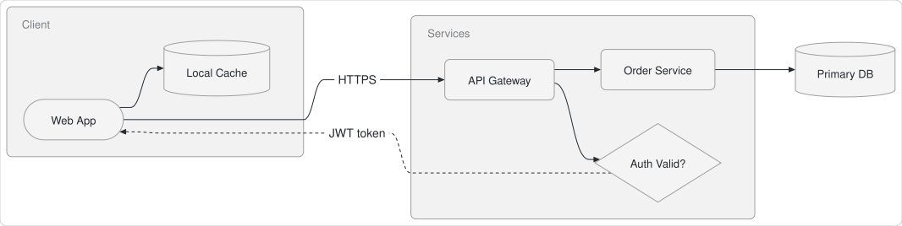
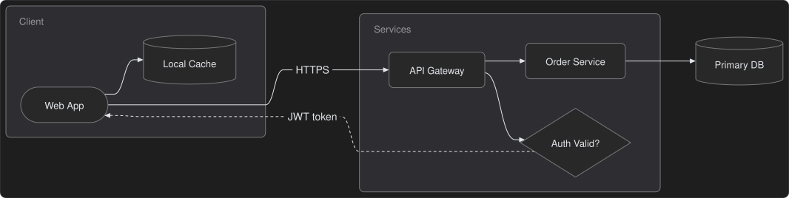
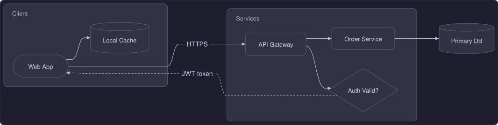
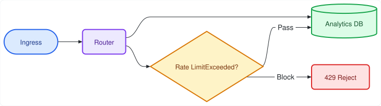

# `pele_dart`

[](https://pub.dev/packages/pele_dart)
[](https://github.com/tkinnis/pele_dart/actions/workflows/ci.yml)
[](https://github.com/obsidianmd/pele)
[](LICENSE)

A fast, deterministic, zero-DOM **pure Dart** Mermaid diagram layout and SVG rendering engine.

**`pele_dart`** is a 1:1 pure-Dart port of [**`obsidianmd/pele`**](https://github.com/obsidianmd/pele) ([`pele.run`](https://pele.run))—the lightweight, synchronous, zero-dependency TypeScript Mermaid renderer created by [**Steph Ango (`kepano`)**](https://github.com/kepano) and the [**Obsidian**](https://obsidian.md) team—augmented with a native SVG 1.1 flattener for Flutter's `vector_graphics_compiler` (`encodeSvg`).

---

## Highlights

* **Pure Dart 3 (`sdk: ^3.13.0`)**: Zero browser (`WKWebView` / `WebKitGTK` / `WebView2`), zero JavaScript runtime (`QuickJS` / `JavaScriptCore`), and zero Flutter SDK dependency in the core package. Runs synchronously in CLI tools, servers, background Dart isolates (`Isolate.run`), and Flutter apps.
* **100% Byte-for-Byte Upstream Parity (`787/787`)**: Produces byte-for-byte identical SVG markup to upstream [`obsidianmd/pele`](https://github.com/obsidianmd/pele) (`v1.13.0`) across all 33 canonical diagram families, all 232 showcase/playground samples, and all 522 upstream test corpus diagrams.
* **Dual SVG Output Modes (`SvgOutputMode`)**:
  1. **`SvgOutputMode.flattened`** *(Default)*: Resolves all `--pele-*` and `--_*` CSS custom properties, `color-mix(in srgb, ...)` blends, `calc(...)` expressions, `currentColor`, `<tspan>` `baseline-shift`, and inline `style="..."` properties against a `PelePalette` into static SVG 1.1 attributes—ready for immediate compilation with Flutter's `vector_graphics_compiler` (`encodeSvg`) or static PDF/PNG rasterizers.
  2. **`SvgOutputMode.cssVariables`** *(Upstream Parity Mode)*: Emits upstream `obsidianmd/pele`'s exact theme-reactive SVG styled via `var(--pele-*)` CSS custom properties so a single SVG adapts dynamically to light/dark CSS themes on the web.
* **Built-in Safety & Resource Limits**: Escapes diagram text, sanitizes link/image URL schemes (`http`, `https`, `mailto`, `tel`), and enforces configurable DoS budgets (`limit` input characters, `maxEdges`, recursion depth protection, and `outputLimit` SVG characters).
* **macOS 3-Way Comparison Studio (`example/`)**: A desktop workbench for side-by-side visual rendering, pixel-diff / split-curtain inspection, and SVG markup diffing across `pele_dart` (Pure Dart), `obsidianmd/pele` (JS), and `mermaid.js`, complete with a live CSS style editor and dynamic `.mmd` / `.mermaid` folder browser.

---

## Visual Render Showcase (Pure Dart Output)

Every image below is a standalone SVG generated directly by `pele_dart` in pure Dart (`SvgOutputMode.flattened`) with zero browser or JavaScript runtime.

> **[Browse All 33 Diagram Families in the Visual Diagram Gallery (`docs/DIAGRAM_GALLERY.md`) →](docs/DIAGRAM_GALLERY.md)**

| Flowchart (`flowchart`) | Sequence Diagram (`sequenceDiagram`) |
| :---: | :---: |
|  |  |
| **State Diagram (`stateDiagram-v2`)** | **Mindmap (`mindmap`)** |
|  |  |
| **Architecture (`architecture-beta`)** | **Sankey (`sankey`)** |
|  |  |

### Custom Styling & Palettes

Consumers can use the built-in defaults (`PelePalette.light` or `PelePalette.dark`) or supply their own `PelePalette(...)`, `--pele-*` CSS custom properties, or in-diagram Mermaid `classDef` / `style` directives. See [**Section 5 of the API User Manual**](docs/API_MANUAL.md#5-theming-styling--customization) for complete examples.

| Default Light (`PelePalette.light`) | Default Dark (`PelePalette.dark`) |
| :---: | :---: |
|  |  |
| **Custom Palette Example (Catppuccin Mocha)** | **In-Diagram Mermaid `classDef` Styling** |
|  |  |

---

## Installation

Add `pele_dart` from `pub.dev`:

```bash
dart pub add pele_dart
```

Or in your `pubspec.yaml`:

```yaml
dependencies:
  pele_dart: ^0.1.0
```

---

## Quick Start

### 1. Render a Mermaid Diagram to Flattened SVG

```dart
import 'package:pele_dart/pele_dart.dart';

void main() {
  const source = '''
flowchart LR
  A[Start] --> B{Decision}
  B -->|Yes| C[Ship It]
  B -->|No| D[Revise]
''';

  final RenderResult result = render(
    source,
    const RenderOptions(
      outputMode: SvgOutputMode.flattened,
      palette: PelePalette.light,
    ),
  );

  print('Type: ${result.type} (${result.mermaidType})');
  print('Size: ${result.width} x ${result.height}');
  print(result.svg);
}
```

### 2. Two-Phase Parse & Re-Render (Fast Theme Switching)

Parse a diagram once with `parse()` and pass the model to `render()` to switch palettes or container widths without re-parsing:

```dart
final model = parse('sequenceDiagram\n  Alice->>Bob: Ping\n  Bob-->>Alice: Pong');

final lightSvg = render(model, const RenderOptions(palette: PelePalette.light)).svg;
final darkSvg  = render(model, const RenderOptions(palette: PelePalette.dark)).svg;
```

### 3. Detection & Error Handling (`PeleError`)

```dart
if (supports(source)) {
  try {
    final result = render(source);
  } on PeleError catch (e) {
    // e.code: 'syntax' | 'semantic' | 'unsupported-diagram' | 'limit'
    print('Error (${e.code}) at ${e.line}:${e.column}:\n${e.snippet}');
  }
}
```

### 4. Flutter `vector_graphics_compiler` Integration

Because `SvgOutputMode.flattened` resolves all CSS custom properties, `color-mix()` blends, `currentColor`, and inline styles into static SVG 1.1 attributes, the output compiles directly with `package:vector_graphics_compiler`:

```dart
final result = render(
  mermaidSource,
  RenderOptions(
    outputMode: SvgOutputMode.flattened,
    palette: isDark ? PelePalette.dark : PelePalette.light,
  ),
);

final Uint8List vectorBytes = encodeSvg(
  xml: result.svg,
  debugName: 'mermaid_${result.type}',
  enableClippingOptimizer: false,
  enableMaskingOptimizer: false,
  enableOverdrawOptimizer: false,
);
```

See [**Section 11 of the API User Manual**](docs/API_MANUAL.md#11-integration-guides) for a complete Flutter `StatelessWidget` example.

---

## Supported Diagram Families (33 Types)

`pele_dart` supports all **33** diagram families from `obsidianmd/pele` (`v1.13.0`), targeting Mermaid `12.1.0` syntax plus Pele's extended architecture and systems-thinking diagrams:

### Core Mermaid Diagrams (10)

| Family | `DiagramType` | Mermaid Header Keyword(s) | Visual Render |
| :--- | :--- | :--- | :--- |
| **Flowchart** | `flowchart` | `flowchart`, `graph`, `flowchart-elk` | [View SVG](docs/images/diagrams/flowchart.svg) |
| **Sequence** | `sequence` | `sequenceDiagram` | [View SVG](docs/images/diagrams/sequence.svg) |
| **Class** | `class` | `classDiagram` | [View SVG](docs/images/diagrams/class.svg) |
| **State** | `state` | `stateDiagram`, `stateDiagram-v2` | [View SVG](docs/images/diagrams/state.svg) |
| **Entity Relationship** | `er` | `erDiagram` | [View SVG](docs/images/diagrams/er.svg) |
| **Gantt** | `gantt` | `gantt` | [View SVG](docs/images/diagrams/gantt.svg) |
| **Git Graph** | `gitGraph` | `gitGraph` | [View SVG](docs/images/diagrams/git.svg) |
| **Mindmap** | `mindmap` | `mindmap` | [View SVG](docs/images/diagrams/mindmap.svg) |
| **Pie** | `pie` | `pie` | [View SVG](docs/images/diagrams/pie.svg) |
| **Info** | `info` | `info` | [View SVG](docs/images/diagrams/info.svg) |

### Extended & Architecture Diagrams (23)

| Family | `DiagramType` | Mermaid Header Keyword(s) | Visual Render |
| :--- | :--- | :--- | :--- |
| **Agentflow** | `agentflow` | `agentflow-beta` | [View SVG](docs/images/diagrams/agentflow.svg) |
| **Architecture** | `architecture` | `architecture`, `architecture-beta` | [View SVG](docs/images/diagrams/architecture.svg) |
| **Block** | `block` | `block`, `block-beta` | [View SVG](docs/images/diagrams/block.svg) |
| **C4** | `c4` | `C4Context`, `C4Container`, `C4Component`, `C4Dynamic`, `C4Deployment` | [View SVG](docs/images/diagrams/c4.svg) |
| **Cynefin** | `cynefin` | `cynefin-beta` | [View SVG](docs/images/diagrams/cynefin.svg) |
| **Event Modeling** | `eventmodeling` | `eventmodeling` | [View SVG](docs/images/diagrams/eventmodeling.svg) |
| **Ishikawa (Fishbone)** | `ishikawa` | `ishikawa`, `ishikawa-beta` | [View SVG](docs/images/diagrams/ishikawa.svg) |
| **User Journey** | `journey` | `journey` | [View SVG](docs/images/diagrams/journey.svg) |
| **Kanban** | `kanban` | `kanban` | [View SVG](docs/images/diagrams/kanban.svg) |
| **Packet** | `packet` | `packet`, `packet-beta` | [View SVG](docs/images/diagrams/packet.svg) |
| **Quadrant Chart** | `quadrantChart` | `quadrantChart` | [View SVG](docs/images/diagrams/quadrant.svg) |
| **Radar** | `radar` | `radar-beta` | [View SVG](docs/images/diagrams/radar.svg) |
| **Railroad (EBNF/ABNF/PEG)** | `railroad` | `railroad-beta`, `railroad-ebnf-beta`, `railroad-abnf-beta`, `railroad-peg-beta` | [View SVG](docs/images/diagrams/railroad.svg) |
| **Requirement** | `requirement` | `requirementDiagram`, `requirement` | [View SVG](docs/images/diagrams/requirement.svg) |
| **Sankey** | `sankey` | `sankey`, `sankey-beta` | [View SVG](docs/images/diagrams/sankey.svg) |
| **Swimlane** | `swimlane` | `swimlane-beta` | [View SVG](docs/images/diagrams/swimlane.svg) |
| **Timeline** | `timeline` | `timeline` | [View SVG](docs/images/diagrams/timeline.svg) |
| **Treemap** | `treemap` | `treemap`, `treemap-beta` | [View SVG](docs/images/diagrams/treemap.svg) |
| **Tree View** | `treeView` | `treeView-beta` | [View SVG](docs/images/diagrams/treeview.svg) |
| **Use Case** | `usecase` | `usecase-beta` | [View SVG](docs/images/diagrams/usecase.svg) |
| **Venn** | `venn` | `venn-beta` | [View SVG](docs/images/diagrams/venn.svg) |
| **Wardley Map** | `wardley` | `wardley-beta` | [View SVG](docs/images/diagrams/wardley.svg) |
| **XY Chart** | `xychart` | `xychart`, `xychart-beta` | [View SVG](docs/images/diagrams/xychart.svg) |

---

## macOS 3-Way Comparison Studio (`example/`)

The repository includes a macOS desktop showcase and comparison workbench in [`example/`](example/README.md) that renders every diagram side-by-side across **`pele_dart` (Pure Dart)**, **`obsidianmd/pele` (JS)**, and **`mermaid.js`**:

```bash
cd example
flutter run -d macos
```

* **Gallery Folder Browser (`example/diagrams/`)**: Dynamically scans `.mmd` and `.mermaid` text files organized under `01_core/`, `02_extended/`, and `03_custom/`. Drop new `.mmd` or `.mermaid` files into any subfolder and click **Rescan (`↻`)** to browse them immediately.
* **4 Inspection Modes**: **Visual Render** (synchronized pan/zoom), **Visual Diff** (split-curtain swipe, Cyan/Magenta channel overlay, pixel-diff heatmap, and blink toggle), **Raw SVG**, and **SVG Text Diff** (inline diff + external diff launcher).
* **Live Mermaid & CSS Style Playground**: Edit Mermaid source or switch to the **`Style (CSS)`** tab to test custom `--pele-*` CSS variables and style presets in real time.

---

## Documentation

* **[Visual Diagram Gallery (`docs/DIAGRAM_GALLERY.md`)](docs/DIAGRAM_GALLERY.md)**: Clean standalone SVG renders and Mermaid source code for all 33 supported diagram families.
* **[API User Manual (`docs/API_MANUAL.md`)](docs/API_MANUAL.md)**: Complete reference covering `render`, `renderMermaid`, `parse`, `detectType`, `supports`, `SvgOutputMode`, `PelePalette` theming & custom palettes, `RenderOptions`, `ParseOptions`, `PeleError`, custom `TextMeasurer` / `IconResolver` / `MathResolver`, and Flutter integration.
* **[Example & Comparison Studio Guide (`example/README.md`)](example/README.md)**: Guide to pure-Dart CLI usage and the macOS 3-Way Comparison Studio.
* **[Upstream Sync & Release Guide (`docs/UPSTREAM_SYNC.md`)](docs/UPSTREAM_SYNC.md)**: Workflow for detecting upstream `obsidianmd/pele` releases (`dart run tool/sync_upstream.dart`), staging diffs, and running the 787-diagram differential verification suite (`dart run tool/verify_against_upstream.dart`).
* **[Architecture & Design (`docs/DESIGN.md`)](docs/DESIGN.md)**: Architectural overview, dual SVG emission strategy, and TypeScript-to-Dart translation rules.
* **[Upstream Tracking Matrix (`UPSTREAM.md`)](UPSTREAM.md)**: Pinned `obsidianmd/pele` release tag, commit SHA, target Mermaid version, and per-module porting status matrix.
* **[Contributing Guide (`CONTRIBUTING.md`)](CONTRIBUTING.md)**: Guidelines for reporting issues, submitting pull requests, and running quality gates.

---

## Credits, Attribution & License

`pele_dart` is a pure-Dart port of [**`obsidianmd/pele`**](https://github.com/obsidianmd/pele) ([`pele.run`](https://pele.run)), created by [**Steph Ango (`kepano`)**](https://github.com/kepano) and the [**Obsidian**](https://obsidian.md) team. All credit for the original parser architecture, deterministic layout algorithms, and `--pele-*` visual design system belongs to the upstream `obsidianmd/pele` authors.

* **`pele_dart`**: Copyright (c) 2026 Tony Kinnis — licensed under the [MIT License](LICENSE).
* **Upstream `obsidianmd/pele`**: Copyright (c) 2026 kepano — licensed under the [MIT License](https://github.com/obsidianmd/pele/blob/main/LICENSE).
* **Built-in Icons**: Includes icon paths from [Lucide](https://lucide.dev), Copyright (c) 2026 Lucide Icons and Contributors — licensed under the [ISC License](LICENSE).
* **Mermaid Syntax & Compatibility Fixtures**: Targets [Mermaid](https://mermaid.js.org) syntax specifications — licensed under the [MIT License](https://github.com/mermaid-js/mermaid/blob/develop/LICENSE).
