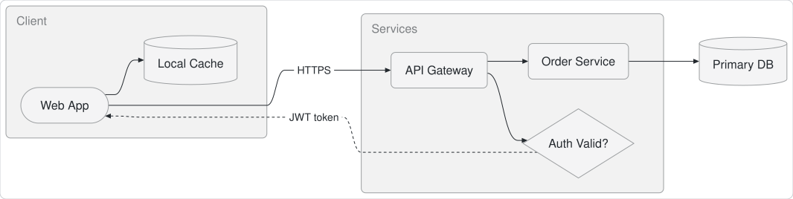
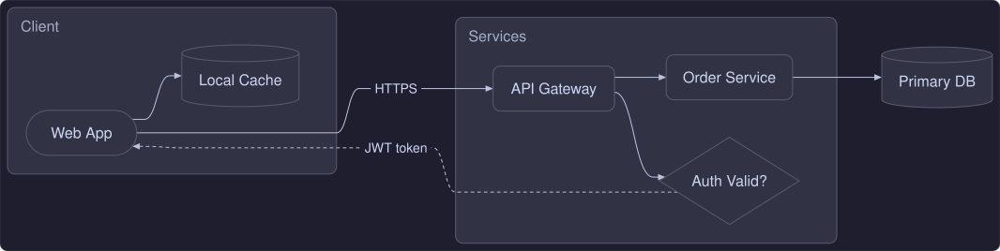

#  pele_dart

[](https://pub.dev/packages/pele_dart)
[](https://github.com/tkinnis/pele_dart/actions/workflows/ci.yml)
[-00b4d8)](doc/BENCHMARKS.md)
[](UPSTREAM.md)
[](LICENSE)

**pele_dart** renders [Mermaid](https://mermaid.js.org) diagrams to SVG in pure Dart. It is fast, synchronous, has zero browser or JavaScript dependencies, and outputs both themeable CSS-variable SVG and static SVG 1.1 ready for Flutter.

Ported 1:1 from [Pele](https://pele.run) ([obsidianmd/pele](https://github.com/obsidianmd/pele)) by [Steph Ango](https://github.com/kepano) and the [Obsidian](https://obsidian.md) team.

## Highlights

* **Pure Dart**: Synchronous layout and SVG rendering with zero WebView, zero JavaScript runtime, and zero Flutter SDK dependency in the core package.
* **100% Upstream Parity**: Version-locked 1:1 to [obsidianmd/pele](https://github.com/obsidianmd/pele) across every supported diagram family and test suite (see [Upstream Tracking](UPSTREAM.md)).
* **2.2x Faster in Native AOT**: Renders the full showcase corpus in **~10.2 ms** (**43.8 µs** mean per diagram)—up to **4.5x faster** on complex diagrams than JavaScript (see [Performance Benchmarks](doc/BENCHMARKS.md)).
* **Flutter & Web Ready**: Emit static SVG 1.1 attributes for Flutter's `vector_graphics_compiler` (`SvgOutputMode.flattened`) or theme-reactive CSS variables (`SvgOutputMode.cssVariables`).
* **Safe by Default**: Escapes diagram text, filters unsafe URLs, and enforces configurable size and complexity budgets.

## Visual Showcase

Every diagram below is a standalone SVG generated directly by **pele_dart** in pure Dart.

**[→ Browse the Full Visual Diagram Gallery (All Supported Diagram Families)](doc/DIAGRAM_GALLERY.md)**

### Flowchart


| Sequence Diagram | Class Diagram |
| :---: | :---: |
|  |  |

### Custom Styling & Palettes

Use the built-in light and dark palettes, supply a custom `PelePalette`, or style nodes with Mermaid `classDef` directives (see [Theming & Customization](doc/API_MANUAL.md#5-theming-styling--customization)):

**Default Light Palette**



**Catppuccin Mocha Palette**



## Quick Start

```bash
dart pub add pele_dart
```

### Pure Dart

```dart
import 'package:pele_dart/pele_dart.dart';

void main() {
  const source = '''
flowchart LR
  A[Start] --> B{Decision}
  B -->|Yes| C[Ship It]
  B -->|No| D[Revise]
''';

  final RenderResult result = render(
    source,
    const RenderOptions(
      outputMode: SvgOutputMode.flattened,
      palette: PelePalette.light,
    ),
  );

  print('${result.type} (${result.width}x${result.height})');
  print(result.svg);
}
```

### Flutter Vector Graphics

```dart
final result = render(
  mermaidSource,
  RenderOptions(
    outputMode: SvgOutputMode.flattened,
    palette: isDark ? PelePalette.dark : PelePalette.light,
  ),
);

final Uint8List vectorBytes = encodeSvg(
  xml: result.svg,
  debugName: 'mermaid_${result.type}',
  enableClippingOptimizer: false,
  enableMaskingOptimizer: false,
  enableOverdrawOptimizer: false,
);
```

## Documentation

Browse the interactive **[Documentation Portal](https://tkinnis.github.io/pele_dart/)** or jump directly to a guide:

| Guide | Description |
| :--- | :--- |
| **[API User Manual](doc/API_MANUAL.md)** | Complete reference for `render`, `parse`, `detectType`, `supports`, `PelePalette`, `PeleError`, custom resolvers, and Flutter integration. |
| **[Visual Diagram Gallery](doc/DIAGRAM_GALLERY.md)** | Rendered SVG outputs and Mermaid source for all supported diagram families—Flowchart, Sequence, Class, State, ER, C4, Architecture, Sankey, XY Chart, Gantt, Kanban, Mindmap, Radar, Timeline, and more. |
| **[Performance Benchmarks](doc/BENCHMARKS.md)** | Native Dart AOT vs JavaScript benchmarks across the full gallery corpus and phase breakdowns. |
| **[Pele Studio Guide](doc/STUDIO_GUIDE.md)** | Guide to **Pele Studio**, the macOS 3-way visual and SVG diff workbench. |

**Architecture & Maintainer Docs:** [Architecture & Internals](doc/ARCHITECTURE.md) · [Upstream Tracking](UPSTREAM.md) · [Upstream Sync Guide](doc/UPSTREAM_SYNC.md) · [Contributing Guide](CONTRIBUTING.md)

## Credits & License

**pele_dart** is a pure-Dart port of [Pele](https://pele.run) ([obsidianmd/pele](https://github.com/obsidianmd/pele)), created by [Steph Ango](https://github.com/kepano) and the [Obsidian](https://obsidian.md) team. All credit for the original parser architecture, deterministic layout algorithms, and visual design system belongs to the upstream authors.

* **pele_dart**: Copyright (c) 2026 Tony Kinnis — [MIT License](LICENSE).
* **Upstream obsidianmd/pele**: Copyright (c) 2026 kepano — [MIT License](https://github.com/obsidianmd/pele/blob/main/LICENSE).
* **Built-in Icons**: Includes icon paths from [Lucide](https://lucide.dev) — [ISC License](LICENSE).
