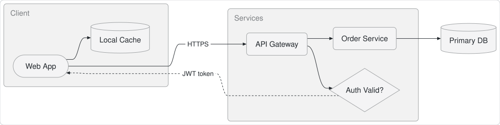
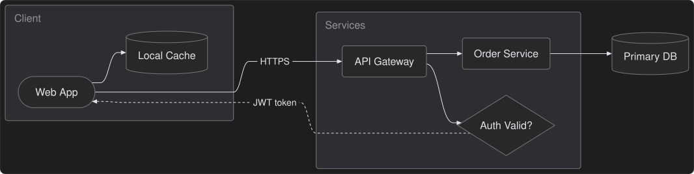
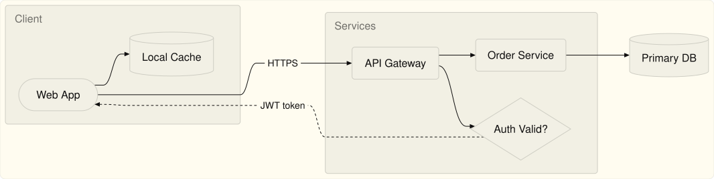
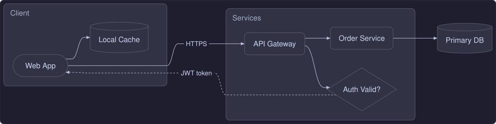
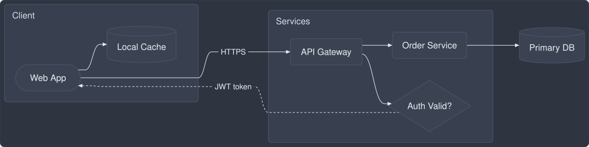
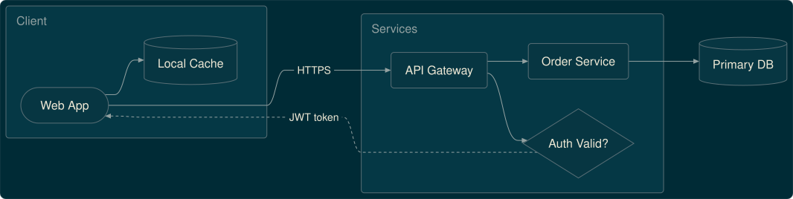
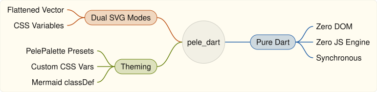
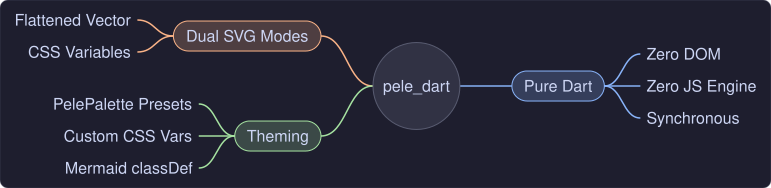
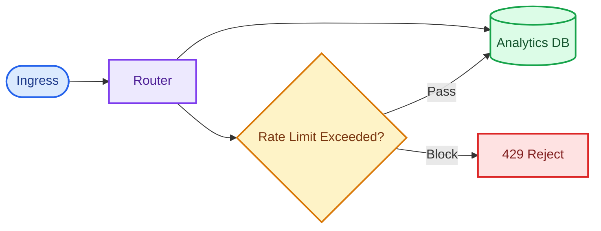
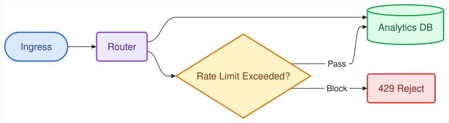

# `pele_dart` API User Manual

`pele_dart` is a fast, deterministic, zero-DOM **pure Dart** Mermaid diagram layout and SVG rendering engine. It is a 1:1 pure-Dart port of [`obsidianmd/pele`](https://github.com/obsidianmd/pele) ([`pele.run`](https://pele.run)), created by Steph Ango (`kepano`) and the Obsidian team.

`pele_dart` renders all supported Mermaid and extended diagram families synchronously into clean SVG with zero browser (`WKWebView`), zero JavaScript engine (`QuickJS` / `JavaScriptCore`), and zero Flutter SDK dependency in the core package.

---

## Table of Contents

1. [Installation](#1-installation)
2. [Quick Start](#2-quick-start)
3. [Core API Functions](#3-core-api-functions)
4. [Dual SVG Output Modes (`SvgOutputMode`)](#4-dual-svg-output-modes-svgoutputmode)
5. [Theming, Styling & Customization](#5-theming-styling--customization)
6. [Configuration Options (`RenderOptions` & `ParseOptions`)](#6-configuration-options-renderoptions--parseoptions)
7. [Return Types (`RenderResult` & `LinkInfo`)](#7-return-types-renderresult--linkinfo)
8. [Error Handling (`PeleError`)](#8-error-handling-peleerror)
9. [Custom Text Measurement, Icons & Math (`TextMeasurer`, `IconResolver`, `MathResolver`)](#9-custom-text-measurement-icons--math-textmeasurer-iconresolver-mathresolver)
10. [Supported Diagram Families](#10-supported-diagram-families)
11. [Integration Guides](#11-integration-guides)
    - [Flutter Vector Graphics (`vector_graphics_compiler`)](#a-flutter-vector-graphics-vector_graphics_compiler)
    - [Web / HTML / Markdown CSS-Variable SVG](#b-web--html--markdown-css-variable-svg)
    - [Two-Phase Parse & Re-Render (Theme Switching)](#c-two-phase-parse--re-render-theme-switching)

---

## 1. Installation

Add `pele_dart` from `pub.dev`:

```bash
dart pub add pele_dart
```

Or directly from GitHub:

```yaml
dependencies:
  pele_dart:
    git:
      url: https://github.com/tkinnis/pele_dart.git
      ref: main
```

Import the library:

```dart
import 'package:pele_dart/pele_dart.dart';
```

---

## 2. Quick Start

### Render a Mermaid diagram to a flattened SVG string (default)

```dart
import 'package:pele_dart/pele_dart.dart';

void main() {
  const source = '''
flowchart LR
  A[Client] -->|HTTPS| B(Load Balancer)
  B --> C{Healthy?}
  C -->|Yes| D[(Primary DB)]
  C -->|No| E[(Replica DB)]
''';

  // Returns RenderResult with svg, width, height, type, mermaidType, and links
  final RenderResult result = render(
    source,
    const RenderOptions(
      outputMode: SvgOutputMode.flattened,
      palette: PelePalette.light,
    ),
  );

  print('Detected type: ${result.type} (${result.mermaidType})');
  print('Dimensions: ${result.width} x ${result.height}');
  print(result.svg);
}
```

### Convenience one-liner (`renderMermaid`)

If you only need the SVG markup string:

```dart
final String svg = renderMermaid(
  'sequenceDiagram\n  Alice->>Bob: Hello!',
  options: const RenderOptions(palette: PelePalette.dark),
);
```

---

## 3. Core API Functions

### `render(Object source, [RenderOptions options = const RenderOptions()]) → RenderResult`

Parses, lays out, and renders a Mermaid diagram synchronously.

- **`source`**: Either a raw Mermaid `String` (including optional YAML frontmatter or `%%{init: ...}%%` directives) **or** a pre-parsed model object previously returned by [`parse()`](#parsestring-text-parseoptions-options--const-parseoptions--object).
- **`options`**: Controls SVG output mode, color palette, typography, sizing, link/image security schemes, resource limits, and custom icon/math resolvers.
- **Returns**: [`RenderResult`](#7-return-types-renderresult--linkinfo) containing `svg`, `width`, `height`, `type`, `mermaidType`, and `links`.
- **Throws**: [`PeleError`](#8-error-handling-peleerror) on syntax errors, semantic validation errors, unsupported diagram types, or resource limit violations.

### `renderMermaid(String source, {RenderOptions options = const RenderOptions()}) → String`

Convenience wrapper around `render(source, options).svg`.

### `parse(String text, [ParseOptions options = const ParseOptions()]) → Object`

Parses a Mermaid diagram source string into an internal model and caches its metadata so it can be passed directly to `render(model, options)` multiple times (for example, to re-render across light/dark themes or different `maxWidth` breakpoints without re-parsing).

```dart
final model = parse(mermaidSource);
final lightSvg = render(model, const RenderOptions(palette: PelePalette.light)).svg;
final darkSvg  = render(model, const RenderOptions(palette: PelePalette.dark)).svg;
```

### `detectType(String text) → DiagramType?`

Preprocesses frontmatter/directives and returns the canonical `DiagramType` identifier (e.g., `'flowchart'`, `'sequence'`, `'er'`, `'c4'`), or `null` if the input does not match any known Mermaid diagram header.

```dart
final type = detectType('graph TD\n  A --> B'); // 'flowchart'
```

### `supports(String text) → bool`

Returns `true` if `text` is recognized as a registered Mermaid diagram type. Never throws.

```dart
if (supports(codeBlock)) {
  final result = render(codeBlock);
}
```

### `flattenPeleSvg(String svg, {PelePalette palette = PelePalette.light}) → String`

Converts an upstream-style CSS-variable SVG (`SvgOutputMode.cssVariables`) into a static, `vector_graphics_compiler`-compatible SVG 1.1 document by resolving all `var(--_*)` and `var(--pele-*)` CSS custom properties, `color-mix(in srgb, ...)`, `calc(...)`, `currentColor`, `baseline-shift="sub|super"`, and inline `style="..."` presentation/geometry properties into explicit SVG XML attributes. Calling `render(..., RenderOptions(outputMode: SvgOutputMode.flattened))` invokes this automatically.

### `register(Iterable<AnyDiagram> list)` & `registered(DiagramType type) → bool`

All built-in diagram families (`all`) are registered automatically on first use of `render()`, `parse()`, `supports()`, or `registered()`. You can inspect whether a diagram family is registered with `registered('flowchart')` or register custom `Diagram<Model>` implementations via `register([...])`.

### `forgetTextWidths()`

Clears any cached text width measurements (no-op for the stateless built-in `metricsMeasurer`; provided for 1:1 upstream API parity).

---

## 4. Dual SVG Output Modes (`SvgOutputMode`)

`pele_dart` supports two deterministic SVG output modes via `RenderOptions.outputMode`:

| Mode | Enum Value | Best For | Behavior |
| :--- | :--- | :--- | :--- |
| **Flattened** *(Default)* | `SvgOutputMode.flattened` | Flutter desktop/mobile apps (`vector_graphics_compiler` / `vector_graphics`), static PDF/PNG rasterizers, standalone `.svg` files | Resolves all `--pele-*` and `--_*` CSS custom properties, `color-mix(in srgb, ...)` blends, `calc(...)` expressions, and `currentColor` against `RenderOptions.palette` into concrete `#rrggbb` and numeric SVG 1.1 attributes. Converts `<tspan>` `baseline-shift="sub\|super"` into explicit `dy` offsets and promotes inline `style="..."` properties (`rx`, `ry`, `fill`, `stroke`, `stroke-width`, etc.) to native SVG attributes. |
| **CSS Variables** *(Upstream Parity)* | `SvgOutputMode.cssVariables` | Web views, HTML/Markdown exports, differential testing against `obsidianmd/pele` | Emits **100% byte-for-byte identical SVG markup** to upstream `obsidianmd/pele`, styled via `var(--pele-*)` CSS custom properties and `color-mix()` so a single SVG adapts dynamically to light/dark CSS themes without re-rendering. |

---

## 5. Theming, Styling & Customization

`pele_dart` is designed so library consumers can either use the clean built-in defaults (`PelePalette.light` / `PelePalette.dark`) or supply their own custom palette, CSS custom properties, or in-diagram Mermaid styles.

> **Want to see every diagram family rendered by `pele_dart`?**
> Browse the [**Visual Diagram Gallery**](DIAGRAM_GALLERY.md) for clean, standalone SVG renders of every supported diagram family.

### 5.1 Built-in Default Palettes (`PelePalette.light` & `PelePalette.dark`)

Out of the box, `pele_dart` ships two default palettes in the core package:

- **`PelePalette.light`** *(default)*: Matches upstream `obsidianmd/pele` CSS variable fallbacks (`bg: '#ffffff'`, `fg: '#1f1f1f'`, `muted: '#6e6e6e'`, `surface: '#f3f3f3'`, `surfaceAlt: '#e6e6e6'`, `border: '#8a8a8a'`, `accent: '#5b7bd5'`, `critical: '#e45756'`, `radius: 4`).
- **`PelePalette.dark`**: High-contrast dark palette (`bg: '#1e1e1e'`, `fg: '#e1e4e8'`, `surfaceAlt: '#3f3f46'`, `critical: '#f87171'`).

```dart
final lightSvg = render(
  source,
  const RenderOptions(palette: PelePalette.light),
).svg;

final darkSvg = render(
  source,
  const RenderOptions(palette: PelePalette.dark),
).svg;
```

**`PelePalette.light` (Default Light):**



**`PelePalette.dark` (Default Dark):**



---

### 5.2 Supplying Your Own Custom `PelePalette` (`SvgOutputMode.flattened`)

When rendering to static, self-contained SVGs (`SvgOutputMode.flattened`, the default for Flutter `vector_graphics` and PDF/PNG exporters), construct a `PelePalette(...)` matching your application's theme tokens and pass it to `RenderOptions(palette: ...)`:

```dart
const myCustomPalette = PelePalette(
  bg: '#1e1e2e',
  fg: '#cdd6f4',
  muted: '#a6adc8',
  line: '#bac2de',
  surface: '#313244',
  surfaceAlt: '#45475a',
  border: '#585b70',
  accent: '#89b4fa',
  code: '#cdd6f4',
  critical: '#f38ba8',
  fgOnLight: '#1e1e2e',
  fgOnDark: '#cdd6f4',
  radius: 8,
  strokeWidth: 1.25,
  thickStrokeWidth: 2.5,
  hairlineStrokeWidth: 0.5,
  fontFamily: 'Inter, -apple-system, BlinkMacSystemFont, sans-serif',
  monoFontFamily: 'JetBrains Mono, SFMono-Regular, Menlo, monospace',
  colors: <String>[
    '#89b4fa',
    '#fab387',
    '#a6e3a1',
    '#f38ba8',
    '#94e2d5',
    '#f9e2af',
    '#cba6f7',
    '#f5c2e7',
  ],
);

final result = render(
  source,
  const RenderOptions(
    outputMode: SvgOutputMode.flattened,
    palette: myCustomPalette,
  ),
);
```

Below are four examples of consumer-supplied custom `PelePalette` instances rendering the exact same Mermaid diagram:

#### Example A: Warm Paper Custom Palette (`bg: '#fffcf0'`, `accent: '#205ea6'`, `radius: 4`)



#### Example B: Catppuccin Mocha Custom Palette (`bg: '#1e1e2e'`, `accent: '#89b4fa'`, `radius: 8`)



#### Example C: Nord Blueprint Custom Palette (`bg: '#2e3440'`, `accent: '#88c0d0'`, `radius: 5`)



#### Example D: Solarized Dark Custom Palette (`bg: '#002b36'`, `accent: '#268bd2'`, `radius: 4`)



---

### 5.3 Categorical Series Colors (`PelePalette.colors`)

Multi-branch and data-driven diagrams (`mindmap`, `pie`, `sankey`, `xychart`, `gantt`, `timeline`, `gitGraph`, `radar`, `treemap`, `journey`, `venn`, `cynefin`) cycle through the 8 categorical colors in `PelePalette.colors` (`--pele-series-1` through `--pele-series-8`).

Supplying your own `colors: <String>[...]` list on `PelePalette` restyles every categorical diagram while maintaining automatic contrast on filled nodes:

**Warm Earthy Series (`colors: ['#205ea6', '#bc5215', '#66800b', '#af3029', ...]`):**



**Pastel Dark Series (`colors: ['#89b4fa', '#fab387', '#a6e3a1', '#f38ba8', ...]`):**



---

### 5.4 Automatic Derived Palette Tokens

You only need to specify the tokens you want to customize. If `muted`, `line`, `surface`, `border`, `accent`, or `code` are omitted (`null`), `PelePalette` automatically derives them using the exact same sRGB color-mixing ratios as upstream `obsidianmd/pele`:

| `PelePalette` Field | CSS Variable | Default / Derived Formula | Description |
| :--- | :--- | :--- | :--- |
| `bg` | `--pele-bg` | `'#ffffff'` (light) / `'#1e1e1e'` (dark) | Canvas background color used for label halos and color mixing |
| `fg` | `--pele-fg` | `'#1f1f1f'` (light) / `'#e1e4e8'` (dark) | Primary text and foreground color |
| `muted` | `--pele-muted` | `'#6e6e6e'` (light) / `60% fg + 40% bg` | Secondary labels, captions, cardinality, and axis ticks |
| `line` | `--pele-line` | `fg` | Connector edges, arrows, lifelines, and dividers |
| `surface` | `--pele-surface` | `'#f3f3f3'` (light) / `5% fg + 95% bg` | Default node, box, and card fill |
| `surfaceAlt` | `--pele-surface-alt` | `'#e6e6e6'` (light) / `'#3f3f46'` (dark) | Secondary container, cluster, and table header fill |
| `border` | `--pele-border` | `'#8a8a8a'` (light) / `45% fg + 55% bg` | Node, subgraph, and container border stroke |
| `accent` | `--pele-accent` | `'#5b7bd5'` | Primary highlight, active state, and milestone accent |
| `code` | `--pele-code` | `8% fg + 92% bg` | Inline code pill background fill |
| `critical` | `--pele-critical` | `'#e45756'` (light) / `'#f87171'` (dark) | Critical path (Gantt) and danger/error accents |
| `fgOnLight` | `--pele-fg-on-light` | `null` (upstream fallback `#1f1f1f`) | Contrast text color placed over bright categorical fills |
| `fgOnDark` | `--pele-fg-on-dark` | `null` (upstream fallback `#fff`) | Contrast text color placed over dark categorical fills |
| `radius` | `--pele-radius` | `4` (`px`) | Default corner radius for rounded boxes and cards |
| `strokeWidth` | `--pele-stroke-width` | `1.25` (`px`) | Standard node and edge stroke width |
| `thickStrokeWidth` | `--pele-thick-stroke-width` | `2.5` (`px`) | Thick edge and highlighted border stroke width |
| `hairlineStrokeWidth` | `--pele-hairline-stroke-width` | `0.5` (`px`) | Subtle gridline and divider stroke width |
| `fontFamily` | `--pele-font` | System sans-serif stack | Primary diagram font family |
| `monoFontFamily` | `--pele-font-mono` | System monospace stack | Monospace font family for code and railroad terminals |
| `colors` | `--pele-series-1`..`8` | `['#4c78a8', '#f58518', '#54a24b', '#e45756', '#72b7b2', '#eeca3b', '#b279a2', '#9d755d']` | 8-color categorical series palette for charts, mindmaps, pies, and sankeys |

---

### 5.5 Styling via CSS Custom Properties (`SvgOutputMode.cssVariables`)

When rendering for HTML, WebViews, or Markdown documents (`outputMode: SvgOutputMode.cssVariables`), `pele_dart` emits `<svg class="pele" ...>` referencing `var(--pele-*)` CSS custom properties with fallback values. You can style all diagrams on a page with standard CSS:

```css
.pele {
  --pele-bg: #1e1e2e;
  --pele-fg: #cdd6f4;
  --pele-muted: #a6adc8;
  --pele-line: #bac2de;
  --pele-surface: #313244;
  --pele-surface-alt: #45475a;
  --pele-border: #585b70;
  --pele-accent: #89b4fa;
  --pele-critical: #f38ba8;
  --pele-radius: 8px;
  --pele-series-1: #89b4fa;
  --pele-series-2: #fab387;
  --pele-series-3: #a6e3a1;
  --pele-series-4: #f38ba8;
}
```

---

### 5.6 In-Diagram Mermaid Styling (`classDef`, `style`, and `themeVariables`)

In addition to host-level `PelePalette` and CSS theming, `pele_dart` supports standard Mermaid inline styling directives inside any diagram source:

- **`classDef <name> fill:...,stroke:...,color:...,stroke-width:...,stroke-dasharray:...`** and **`nodeId:::<name>`** (or `class nodeA,nodeB <name>`)
- **`style <nodeOrSubgraphId> fill:...,stroke:...,color:...`**
- **Frontmatter / `%%{init: {'themeVariables': { ... }}}%%` overrides** (`primaryColor`, `primaryTextColor`, `primaryBorderColor`, `lineColor`, `secondaryColor`, `tertiaryColor`, `fontFamily`, `fontSize`)





> **Interactive Style Playground in Pele Studio:**
> Launch the macOS comparison workbench (`cd studio && flutter run -d macos --release` — see the [Pele Studio User Guide](STUDIO_GUIDE.md)) to switch between canned style presets in the top toolbar or open the **`Style (CSS)`** tab in the Playground Editor to type in your own `--pele-*` variables and preview them live across `pele_dart` and `obsidianmd/pele`.

---

## 6. Configuration Options (`RenderOptions` & `ParseOptions`)

### `RenderOptions`

| Option | Type | Default | Description |
| :--- | :--- | :--- | :--- |
| `outputMode` | `SvgOutputMode` | `SvgOutputMode.flattened` | `SvgOutputMode.flattened` or `SvgOutputMode.cssVariables`. |
| `palette` | `PelePalette` | `PelePalette.light` | Palette used when `outputMode == SvgOutputMode.flattened`. |
| `measurer` | `TextMeasurer?` | `metricsMeasurer` | Custom text width measurer for proportional and monospace fonts. |
| `fontFamily` | `String?` | `null` | Override primary font family in `SvgOutputMode.cssVariables`. |
| `fontFamilyMono` | `String?` | `null` | Override monospace font family in `SvgOutputMode.cssVariables`. |
| `monospace` | `List<MonospacePart>?` | `null` | Diagram parts to render in monospace (`'members'`, `'attributes'`, `'files'`, `'messages'`). |
| `fontSize` | `double?` | `16` | Base font size in pixels. |
| `idPrefix` | `String?` | `null` | Prefix for generated SVG `id` attributes to prevent DOM collisions. |
| `responsive` | `bool?` | `true` (unless `useMaxWidth: false`) | Emits `style="max-width: <W>px"` instead of fixed `width`/`height` attributes. |
| `maxWidth` | `double?` | `null` | Target container width in pixels for auto-direction and layout tightening. |
| `autoDirection` | `bool?` | `true` | Automatically flips `LR`/`RL` diagrams to `TB` when narrower than `directionBreakpoint`. |
| `directionBreakpoint` | `double?` | `640` | Width threshold in pixels for `autoDirection`. |
| `padding` | `double?` | `8` | Outer SVG viewBox padding in pixels. |
| `limit` | `int?` | `50000` | Maximum input source length in characters. |
| `outputLimit` | `int?` | `4000000` | Maximum output SVG length in characters. |
| `maxEdges` | `int?` | `5000` | Maximum number of edges/relations allowed during parsing. |
| `links` | `bool?` | `true` | Whether `click` directives and node links emit `<a>` wrappers / `LinkInfo`. |
| `linkSchemes` | `List<String>?` | `['http', 'https', 'mailto', 'tel']` | Allowed URL schemes for clickable links. |
| `linkRel` | `String?` | `'noopener'` | `rel` attribute added to generated `<a>` tags (pass `''` to omit). |
| `images` | `bool?` | `true` | Whether `<image>` elements are allowed in diagrams. |
| `imageSchemes` | `List<String>?` | `['http', 'https']` | Allowed URL schemes for embedded `<image>` elements. |
| `icons` | `IconResolver?` | Built-in icon pack | Callback `String? Function(String name)` returning inner SVG path markup for icon names. |
| `math` | `MathResolver?` | Built-in TeX layout | Callback `MathMarkup? Function(String tex, double size)` for `$$...$$` math formulas. |
| `config` | `Config?` (`Map<String, YamlValue>?`) | `null` | Extra Mermaid configuration merged with frontmatter / `%%{init}%%` directives. |
| `now` | `Object?` | `null` | Fixed reference date (`DateTime`, ISO `String`, or epoch ms `num`) for deterministic `gantt` today-markers. |

### `ParseOptions`

Passed to `parse(text, ParseOptions(...))` when pre-parsing a diagram model for repeated rendering:

| Option | Type | Default | Description |
| :--- | :--- | :--- | :--- |
| `limit` | `int?` | `50000` | Maximum allowed input source length in characters. |
| `maxEdges` | `int?` | `5000` | Maximum number of edges/relations allowed during parsing. |
| `config` | `Config?` (`Map<String, YamlValue>?`) | `null` | Extra Mermaid configuration merged with YAML frontmatter / `%%{init}%%` directives. |

---

## 7. Return Types (`RenderResult` & `LinkInfo`)

### `RenderResult` (extends `Rendered`)

Returned by `render()`:

| Field | Type | Description |
| :--- | :--- | :--- |
| `svg` | `String` | Complete `<svg ...>...</svg>` document string. |
| `width` | `double` | Intrinsic diagram width in logical pixels (from the SVG `viewBox`). |
| `height` | `double` | Intrinsic diagram height in logical pixels (from the SVG `viewBox`). |
| `type` | `DiagramType` (`String`) | Canonical Pele diagram family name (e.g., `'flowchart'`, `'sequence'`, `'railroad'`). |
| `mermaidType` | `MermaidType` (`String`) | Specific Mermaid header variant (e.g., `'flowchart-v2'`, `'flowchart-elk'`, `'railroadEbnf'`). |
| `links` | `List<LinkInfo>` | Interactive links declared in the diagram (`click` handlers, link nodes). |

### `LinkInfo`

| Field | Type | Description |
| :--- | :--- | :--- |
| `id` | `String` | Node or element identifier associated with the link. |
| `href` | `String` | Sanitized target URL or internal note target. |
| `internal` | `bool` | `true` for internal/wiki links (`internal-link`), `false` for external URLs. |

---

## 8. Error Handling (`PeleError`)

All syntax, semantic, unsupported-diagram, and resource-limit failures throw a structured `PeleError`:

```dart
try {
  final result = render(userInput);
} on PeleError catch (e) {
  print('Error code: ${e.code}');          // 'syntax' | 'semantic' | 'unsupported-diagram' | 'limit'
  print('Diagram type: ${e.type}');        // e.g. 'flowchart' (or null if undetected)
  print('Mermaid type: ${e.mermaidType}'); // e.g. 'flowchart-v2'
  print('Location: line ${e.line}, column ${e.column}');
  print('Snippet:\n${e.snippet}');
  print('Full message:\n${e.message}');
}
```

### `PeleError.code` Values

| Code | Meaning |
| :--- | :--- |
| `'syntax'` | Lexical or grammar error in the diagram source (`line`, `column`, and `snippet` point to the exact position in the original source, even across frontmatter and `%%{init}%%` directives). |
| `'semantic'` | Structural or semantic validation error in a syntactically valid diagram (for example, referencing an undefined node/boundary in C4 or providing an XYChart with no plot series). |
| `'unsupported-diagram'` | No known Mermaid diagram keyword was found, or the diagram type is not registered. |
| `'limit'` | Diagram exceeded safety budgets (`limit` source characters, `maxEdges`, recursion/nesting depth, or `outputLimit` SVG characters). |

---

## 9. Custom Text Measurement, Icons & Math (`TextMeasurer`, `IconResolver`, `MathResolver`)

### Custom `TextMeasurer`

By default, `pele_dart` uses `metricsMeasurer`, a deterministic character-width metrics table ported 1:1 from `obsidianmd/pele` (`src/text/metrics.ts`). It requires zero platform font APIs and produces identical layouts across macOS, Linux, Windows, iOS, Android, and Web.

If you want layout boxes to size against a custom Flutter `TextPainter` or platform font engine, implement `TextMeasurer` and inspect the `Style` bitmask flags (`Style.bold`, `Style.italic`, `Style.mono`, `Style.sub`, `Style.sup`, `Style.underline`):

```dart
class CustomTextMeasurer implements TextMeasurer {
  const CustomTextMeasurer();

  @override
  double width(String text, double size, [int style = 0]) {
    final bool isMono = (style & Style.mono) != 0;
    final bool isBold = (style & Style.bold) != 0;
    final double factor = isMono ? 0.60 : (isBold ? 0.58 : 0.55);
    return text.length * size * factor;
  }
}

final result = render(
  source,
  const RenderOptions(measurer: CustomTextMeasurer()),
);
```

### Custom `IconResolver`

Diagrams such as `architecture`, `flowchart`, `mindmap`, and `treeView` support icon references (e.g., `fa:fa-server`, `lucide:database`, `logos:react`). `pele_dart` bundles upstream's built-in icon paths and also allows custom icon resolution:

```dart
final result = render(
  source,
  RenderOptions(
    icons: (String name) {
      if (name == 'custom:cloud') {
        // Return inner SVG path/shapes tailored to a 24x24 viewBox
        return '<path d="M18 10h-1.26A8 8 0 1 0 9 20h9a5 5 0 0 0 0-10z"/>';
      }
      return null; // Fall back to built-in icons
    },
  ),
);
```

### Custom `MathResolver` (`MathMarkup.svg` / `MathMarkup.html`)

Diagrams supporting LaTeX math expressions (`$$...$$`) use `pele_dart`'s built-in pure-Dart Unicode math layout by default. You can plug in an external TeX-to-SVG or TeX-to-MathML renderer via `RenderOptions.math`:

```dart
final result = render(
  'flowchart LR\n  A["\$\$E = mc^2\$\$"] --> B["\$\$\\nabla \\cdot \\mathbf{E}\$\$"]',
  RenderOptions(
    math: (String tex, double fontSize) {
      // Return pre-rendered SVG markup (or MathMarkup.html(...) for <foreignObject>):
      return MathMarkup.svg(
        svg: '<svg viewBox="0 0 60 20"><text x="0" y="15">$tex</text></svg>',
        width: 60,
        height: 20,
      );
    },
  ),
);
```

---

## 10. Supported Diagram Families

`pele_dart` supports all diagram families from `obsidianmd/pele` (see [`UPSTREAM.md`](../UPSTREAM.md) for the pinned release):

| # | `DiagramType` | `MermaidType` Variant(s) | Mermaid Header Keyword(s) | Description |
| :- | :--- | :--- | :--- | :--- |
| 1 | `flowchart` | `flowchart-v2`, `flowchart-elk` | `flowchart`, `graph`, `flowchart-elk` | Directed & undirected flowcharts, subgraphs, 20+ node shapes |
| 2 | `sequence` | `sequence` | `sequenceDiagram` | Participant lifelines, activations, loops/alt/par/critical blocks, notes |
| 3 | `class` | `classDiagram` | `classDiagram` | UML classes, generics, visibility, inheritance/composition relations, namespaces |
| 4 | `state` | `stateDiagram` | `stateDiagram`, `stateDiagram-v2` | Hierarchical/composite states, fork/join/choice pseudostates, concurrency |
| 5 | `er` | `er` | `erDiagram` | Entity-Relationship models, Crow's foot cardinality, typed attribute tables |
| 6 | `gantt` | `gantt` | `gantt` | Project schedules, sections, milestones, dependencies, excludes, date formatting |
| 7 | `pie` | `pie` | `pie` | Proportional pie charts with optional `showData` values and legend |
| 8 | `mindmap` | `mindmap` | `mindmap` | Balanced hierarchical mindmaps with shapes and icons |
| 9 | `timeline` | `timeline` | `timeline` | Chronological timelines with grouped sections and multi-event periods |
| 10 | `gitGraph` | `gitGraph` | `gitGraph` | Git commit history, branches, merges, cherry-picks, and tags (`LR`, `TB`, `BT`) |
| 11 | `journey` | `journey` | `journey` | User journey maps with satisfaction scores (1–5) and actor assignments |
| 12 | `quadrantChart` | `quadrantChart` | `quadrantChart` | 2x2 strategic quadrant grids with plotted data points |
| 13 | `xychart` | `xychart` | `xychart`, `xychart-beta` | Cartesian bar and line charts with categorical/numeric axes |
| 14 | `sankey` | `sankey` | `sankey`, `sankey-beta` | Proportional flow Sankey diagrams from CSV/link triples |
| 15 | `requirement` | `requirement` | `requirementDiagram`, `requirement` | Systems engineering requirements, risk/verify metadata, and trace links |
| 16 | `c4` | `c4` | `C4Context`, `C4Container`, `C4Component`, `C4Dynamic`, `C4Deployment` | C4 software architecture boundaries, persons, systems, containers, and relations |
| 17 | `kanban` | `kanban` | `kanban` | Agile Kanban boards with columns, cards, assignees, priorities, and metadata |
| 18 | `block` | `block` | `block`, `block-beta` | Multi-column grid block layouts, compound blocks, and spanned arrows |
| 19 | `packet` | `packet` | `packet`, `packet-beta` | Network protocol bit/byte packet header diagrams |
| 20 | `architecture` | `architecture` | `architecture`, `architecture-beta` | Cloud/system architecture groups, services, junctions, and directed ports |
| 21 | `treemap` | `treemap` | `treemap`, `treemap-beta` | Squarified hierarchical treemaps |
| 22 | `radar` | `radar` | `radar-beta` | Multi-axis spider/radar charts with polygon or circle grids |
| 23 | `treeView` | `treeView` | `treeView-beta` | File/directory and hierarchical tree views |
| 24 | `info` | `info` | `info` | Mermaid version/diagnostic info card |
| 25 | `agentflow` | `agentflow` | `agentflow-beta` | AI agent workflow graphs with tool/prompt/memory nodes |
| 26 | `ishikawa` | `ishikawa` | `ishikawa`, `ishikawa-beta` | Fishbone (cause-and-effect) root-cause diagrams |
| 27 | `venn` | `venn` | `venn-beta` | 1-, 2-, and 3-set proportional Venn diagrams with intersection labels |
| 28 | `wardley` | `wardley` | `wardley-beta` | Wardley value-chain evolution maps, pipelines, and movement arrows |
| 29 | `cynefin` | `cynefin` | `cynefin-beta` | Cynefin sense-making framework domains (Clear, Complicated, Complex, Chaotic, Confusion) |
| 30 | `railroad` | `railroad`, `railroadEbnf`, `railroadAbnf`, `railroadPeg` | `railroad-beta`, `railroad-ebnf-beta`, `railroad-abnf-beta`, `railroad-peg-beta` | Syntax railroad track diagrams from DSL, W3C/ISO EBNF, RFC 5234 ABNF, or PEG grammars |
| 31 | `swimlane` | `swimlane` | `swimlane-beta` | Cross-functional swimlane process diagrams |
| 32 | `usecase` | `usecase` | `usecase-beta` | UML Use Case diagrams with stick-figure actors, system boundaries, and `<<include>>`/`<<extend>>` |
| 33 | `eventmodeling` | `eventmodeling` | `eventmodeling` | Event Modeling timelines with UI wireframes, commands, domain events, and read views |

---

## 11. Integration Guides

### A. Flutter Vector Graphics (`vector_graphics_compiler`)

In Flutter desktop or mobile applications, render with `SvgOutputMode.flattened` (the default) and compile the resulting SVG string into a binary vector asset using `package:vector_graphics_compiler` and `package:vector_graphics`:

```dart
import 'dart:typed_data';
import 'package:flutter/material.dart';
import 'package:pele_dart/pele_dart.dart' as pele;
import 'package:vector_graphics/vector_graphics.dart';
import 'package:vector_graphics_compiler/vector_graphics_compiler.dart';

class MermaidDiagramWidget extends StatelessWidget {
  const MermaidDiagramWidget({
    super.key,
    required this.source,
    this.isDark = false,
  });

  final String source;
  final bool isDark;

  @override
  Widget build(BuildContext context) {
    final result = pele.render(
      source,
      pele.RenderOptions(
        outputMode: pele.SvgOutputMode.flattened,
        palette: isDark ? pele.PelePalette.dark : pele.PelePalette.light,
      ),
    );

    final Uint8List compiledBytes = encodeSvg(
      xml: result.svg,
      debugName: 'mermaid_${result.type}',
      enableClippingOptimizer: false,
      enableMaskingOptimizer: false,
      enableOverdrawOptimizer: false,
    );

    return SizedBox(
      width: result.width,
      height: result.height,
      child: VectorGraphic(
        loader: _BytesVectorLoader(compiledBytes),
        width: result.width,
        height: result.height,
        fit: BoxFit.contain,
      ),
    );
  }
}

class _BytesVectorLoader extends BytesLoader {
  const _BytesVectorLoader(this.bytes);
  final Uint8List bytes;

  @override
  Future<ByteData> loadBytes(BuildContext? context) async =>
      ByteData.sublistView(bytes);

  @override
  int get hashCode => bytes.hashCode;

  @override
  bool operator ==(Object other) =>
      other is _BytesVectorLoader && identical(other.bytes, bytes);
}
```

### B. Web / HTML / Markdown CSS-Variable SVG

When embedding diagrams into HTML pages or web apps where CSS handles light/dark mode automatically, use `SvgOutputMode.cssVariables`:

```dart
final result = render(
  source,
  const RenderOptions(outputMode: SvgOutputMode.cssVariables),
);
```

Define the `--pele-*` variables in your stylesheet to switch themes instantaneously without re-rendering:

```css
:root {
  --pele-bg: #ffffff;
  --pele-fg: #24292e;
  --pele-surface-alt: #e6e6e6;
  --pele-critical: #e45756;
}

@media (prefers-color-scheme: dark) {
  :root {
    --pele-bg: #1e1e1e;
    --pele-fg: #e1e4e8;
    --pele-surface-alt: #3f3f46;
    --pele-critical: #f87171;
  }
}
```

### C. Two-Phase Parse & Re-Render (Theme Switching)

If your application switches between light and dark themes or resizes responsive containers frequently, parse the diagram once with `parse()` and pass the model to `render()`:

```dart
final parsedModel = parse(mermaidSource);

// Fast layout + SVG generation without re-lexing or re-parsing:
final lightResult = render(
  parsedModel,
  const RenderOptions(palette: PelePalette.light),
);
final darkResult = render(
  parsedModel,
  const RenderOptions(palette: PelePalette.dark),
);
```
