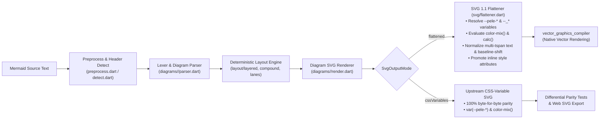

# `pele_dart` Architecture & Internals

* **Upstream Parity**: Version-locked 1:1 to [`obsidianmd/pele`](https://github.com/obsidianmd/pele) across all supported diagram families (`100%` byte-for-byte SVG parity tests; see [Upstream Tracking](../UPSTREAM.md))
* **Public API Reference**: [API User Manual](API_MANUAL.md)
* **Performance & AOT Benchmarks**: [Performance Benchmarks](BENCHMARKS.md)
* **Pele Studio Workbench Guide**: [Pele Studio User Guide](STUDIO_GUIDE.md)
* **Upstream Sync Runbook**: [Upstream Sync Guide](UPSTREAM_SYNC.md)
* **Target SDK**: Pure Dart `^3.13.0` (Zero Flutter, `dart:ui`, Browser, or JavaScript runtime dependencies in the core package)

---

## 1. Architectural Overview

Traditional Mermaid diagram rendering in Dart and Flutter applications requires running a multi-megabyte JavaScript bundle (`mermaid.min.js`) inside an offscreen browser engine (`WKWebView`, `WebKitGTK`, or `WebView2`) and executing DOM-inspection scripts (`getComputedStyle()`, `getBBox()`, `<canvas>` rasterization) because Flutter’s `vector_graphics_compiler` only supports a static subset of SVG 1.1 primitives.

**`pele_dart`** eliminates the browser and JavaScript runtime entirely by providing a **pure Dart 3 library** ported 1:1 from [`obsidianmd/pele`](https://github.com/obsidianmd/pele)—Obsidian’s zero-dependency, synchronous, zero-DOM Mermaid rendering engine—paired with a deterministic **SVG 1.1 flattener** (`lib/src/svg/flattener.dart`) that resolves CSS custom properties, `color-mix()` expressions, and text baseline attributes into static SVG 1.1 primitives ready for `vector_graphics_compiler` (`encodeSvg`).

### Core Architectural Invariants

1. **Zero Browser & Zero JS Runtime**: Renders Mermaid diagrams into SVG synchronously in pure Dart (`sdk: ^3.13.0`), depending only on standard Dart core libraries and `package:meta`. Safe to run on the main isolate, inside `Isolate.run()`, in CLI tools, or on backend servers.
2. **Strict 1:1 Upstream Module & Symbol Parity**: Every file in `obsidianmd/pele/src/` maps directly to `lib/src/` in `pele_dart`, with [`UPSTREAM.md`](../UPSTREAM.md) serving as the single source of truth for the pinned upstream release and commit SHA.
3. **Hermetic Diagram Isolation**: Each diagram family under `lib/src/diagrams/<type>/` (`parser.dart`, `model.dart`, `layout.dart`, `render.dart`) is hermetically isolated from other diagram directories, importing only shared infrastructure (`lib/src/layout/`, `lib/src/svg/`, `lib/src/text/`, `lib/src/util/`, `lib/src/diagrams/common/`).
4. **Dual SVG Output Modes (`SvgOutputMode`)**:
   * **`SvgOutputMode.flattened`** *(Default)*: Emits static SVG 1.1 primitives compatible with `vector_graphics_compiler` (`encodeSvg`).
   * **`SvgOutputMode.cssVariables`** *(Upstream Parity)*: Emits byte-for-byte identical SVG to upstream `obsidianmd/pele` (`var(--pele-*)` CSS custom properties and `color-mix(in srgb, ...)`).
5. **Defense-in-Depth Resource Budgets**: Enforces pre-parse and post-render DoS safety limits (`limit` source characters, `maxEdges` graph edge cap, `outputLimit` SVG characters, and `StackOverflowError` catching for deeply nested diagrams).

---

## 2. End-to-End Rendering Pipeline



### Repository & Module Map (`1:1` with `obsidianmd/pele`)

```text
pele_dart/
├── AGENTS.md                        # AI agent guidelines & architectural invariants
├── UPSTREAM.md                      # Single source of truth for pinned upstream SHA & sync matrix
├── pubspec.yaml                     # Pure Dart package manifest (1:1 version lockstep with UPSTREAM.md)
├── analysis_options.yaml            # Strict analyzer & lint rules
├── doc/
│   ├── API_MANUAL.md                # Public API reference & Flutter integration manual
│   ├── ARCHITECTURE.md              # System architecture & internals (this document)
│   ├── BENCHMARKS.md                # Native Dart AOT vs JS performance benchmarks & regression gate
│   ├── DIAGRAM_GALLERY.md           # Standalone pure-Dart SVG gallery for all supported diagram families
│   ├── STUDIO_GUIDE.md              # Pele Studio macOS 3-way workbench user guide
│   ├── UPSTREAM_SYNC.md             # Upstream release detection, sync & verification runbook
│   └── images/                      # Standalone SVG renders (diagrams/*.svg, styles/*.svg, studio/*.png)
├── lib/
│   ├── pele_dart.dart               # Public library entrypoint
│   └── src/
│       ├── core.dart                # <- src/core.ts
│       ├── detect.dart              # <- src/detect.ts (O(1) first-char header dispatch)
│       ├── errors.dart              # <- src/errors.ts
│       ├── index.dart               # <- src/index.ts
│       ├── preprocess.dart          # <- src/preprocess.ts
│       ├── types.dart               # <- src/types.ts
│       ├── util/
│       │   ├── chars.dart           # <- src/util/chars.ts
│       │   ├── math_js.dart         # Dart helpers for JS 32-bit bitwise/slice semantics
│       │   ├── unicode.dart         # <- src/util/unicode.ts
│       │   ├── url.dart             # <- src/util/url.ts
│       │   └── yaml.dart            # <- src/util/yaml.ts
│       ├── text/
│       │   ├── entities.dart        # <- src/text/entities.ts
│       │   ├── icons.dart           # <- src/text/icons.ts
│       │   ├── label.dart           # <- src/text/label.ts
│       │   ├── math.dart            # <- src/text/math.ts (TeX math layout to SVG)
│       │   ├── measurer.dart        # <- src/text/measurer.ts
│       │   └── metrics.dart         # <- src/text/metrics.ts
│       ├── layout/
│       │   ├── components.dart      # <- src/layout/components.ts
│       │   ├── compound.dart        # <- src/layout/compound.ts
│       │   ├── lanes.dart           # <- src/layout/lanes.ts
│       │   └── layered.dart         # <- src/layout/layered.ts
│       ├── svg/
│       │   ├── builder.dart         # <- src/svg/builder.ts
│       │   ├── cluster.dart         # <- src/svg/cluster.ts
│       │   ├── edges.dart           # <- src/svg/edges.ts
│       │   ├── flattener.dart       # SVG 1.1 palette/CSS resolver & baseline normalizer
│       │   ├── ink.dart             # <- src/svg/ink.ts
│       │   ├── palette.dart         # <- src/svg/palette.ts
│       │   ├── root.dart            # <- src/svg/root.ts
│       │   ├── shapes.dart          # <- src/svg/shapes.ts
│       │   ├── theme.dart           # <- src/svg/theme.ts
│       │   └── title.dart           # <- src/svg/title.ts
│       └── diagrams/
│           ├── registry.dart        # <- src/diagrams/registry.ts
│           ├── common/              # <- src/diagrams/common/ (lexer tokens, outline, curves)
│           ├── flowchart/           # <- src/diagrams/flowchart/
│           ├── sequence/            # <- src/diagrams/sequence/
│           └── ... (all supported diagram directories)
├── test/
│   ├── core_test.dart               # Core detection, preprocessing, layout & API tests
│   ├── flattener_test.dart          # SVG 1.1 flattener, CSS variable, color-mix & tspan tests
│   ├── gallery_corpus_test.dart     # Gallery & upstream corpus parity + encodeSvg tests
│   ├── doc_examples_test.dart       # Documentation code snippets, links & lockstep version gate
│   └── diagrams/                    # Per-diagram unit & vector_graphics_compiler tests
├── tool/
│   ├── sync_upstream.dart           # Reads UPSTREAM.md, diffs obsidianmd/pele & refreshes assets
│   ├── verify_against_upstream.dart # Differential test runner (Bun Pele vs. pele_dart)
│   ├── benchmark_suite.dart         # Native AOT vs JS benchmark runner & regression gate
│   ├── benchmark_baseline.json      # Per-family AOT timing baseline for regression checks
│   └── generate_doc_images.dart     # Generates doc/images/**/*.svg and doc/DIAGRAM_GALLERY.md
├── example/
│   ├── main.dart                    # Standalone pure-Dart CLI example (for pub.dev)
│   └── README.md                    # Pure-Dart usage examples for pub.dev's Example tab
└── studio/
    ├── pubspec.yaml                 # macOS Flutter Comparison Studio manifest
    ├── diagrams/                    # File-based .mmd/.mermaid gallery (01_core, 02_extended, 03_custom)
    ├── macos/
    └── lib/
        ├── main.dart                # macOS 3-Way Comparison Studio UI
        ├── mac_controls.dart        # Native macOS desktop toolbar & inspector controls
        ├── engine_runner.dart       # Adapters for pele_dart, obsidianmd/pele (JS), and mermaid.js
        ├── visual_diff_view.dart    # Split-Curtain, Cyan/Magenta, Heatmap & Blink visual diff modes
        ├── svg_diff_view.dart       # Normalized XML text diff & external diff launcher
        └── gallery_samples.dart     # File-system .mmd/.mermaid scanner & corpus loader
```

---

## 3. Bridging CSS-Variable SVG to `vector_graphics_compiler` (`svg/flattener.dart`)

Upstream `obsidianmd/pele` emits clean, self-contained SVG geometry without `<marker>` arrowheads or HTML `<foreignObject>` layout tables. However, it styles its SVG output using modern CSS features that static SVG 1.1 compilers (`vector_graphics_compiler` / `flutter_svg`) do not support:
* CSS custom properties (`var(--pele-*)` and scoped `var(--_*)` variables)
* CSS Color 5 `color-mix(in srgb, ...)` expressions
* `calc(...)` length expressions and `currentColor`
* Inline `style="..."` geometry/presentation properties (`rx`, `ry`, `fill`, `stroke`, `stroke-dasharray`)
* Multi-`<tspan>` `<text>` blocks and `<tspan baseline-shift="sub|super" font-size="smaller">`

[`lib/src/svg/flattener.dart`](../lib/src/svg/flattener.dart) (`flattenPeleSvg`) resolves all of these deterministically in pure Dart while keeping the diagram renderers 100% 1:1 with upstream `obsidianmd/pele`:

| Upstream Pele Construct | Why `vector_graphics_compiler` Rejects It | How `flattenPeleSvg` Resolves It in Pure Dart |
| :--- | :--- | :--- |
| **`var(--pele-*)`, `var(--_*)` & `color-mix(in srgb, ...)`** | Compiler only parses literal hex (`#rrggbb`), `rgb(...)`, or named SVG colors. | Evaluates all `--pele-*` and scope-inherited `--_*` variable bindings plus nested `color-mix(in srgb, ...)` sRGB blends against `PelePalette`, emitting concrete `#rrggbb` / `rgba(...)` values and `fill-opacity` / `stroke-opacity`. |
| **`calc(...)` & `currentColor`** | Compiler requires numeric length attributes and explicit color values. | Evaluates `calc(...)` arithmetic expressions to numbers and replaces `currentColor` with the resolved foreground color (`--_fg`). |
| **Inline `style="..."` presentation & geometry properties** | Compiler ignores CSS geometry properties (`rx`, `ry`) and certain presentation properties when only specified inside `style="..."`. | Promotes inline `style="..."` properties (`rx`, `ry`, `fill`, `stroke`, `stroke-width`, `stroke-dasharray`, `opacity`, `font-size`, etc.) to native SVG 1.1 XML attributes and attaches `font-family` and `font-size` to the root `<svg>`. |
| **Multi-`<tspan>` `<text>` layout coordinates** | Compiler misaligns sibling `<tspan>` elements inside a single `<text>` node when mixed relative/absolute offsets are used. | `_normalizeMultiSpanTextPositions` splits or normalizes multi-span `<text>` blocks with deterministic horizontal character advances (`metricsMeasurer`) and explicit `x`/`y` coordinates. |
| **`<tspan baseline-shift="sub\|super" font-size="smaller">`** | Compiler ignores `baseline-shift` and relative keyword `font-size="smaller"`. | Converts `baseline-shift="sub\|super" font-size="smaller"` on `<tspan>` elements into explicit `dy="3"` / `dy="-4"` vertical offsets (with reset `dy` on following sibling `<tspan>`s) and numeric `font-size="10"`. |

---

## 4. TypeScript-to-Dart Semantic Translation Rules

Because `obsidianmd/pele` is written in dependency-free strict TypeScript with zero DOM calls, ~95% of its code maps 1:1 to Dart 3. The remaining 5% involves runtime differences between JavaScript and the Dart VM / AOT compiler that are standardized in [`lib/src/util/math_js.dart`](../lib/src/util/math_js.dart) and [`lib/src/svg/builder.dart`](../lib/src/svg/builder.dart):

1. **64-Bit Dart `int` vs. JS 32-Bit Signed Bitwise Operations**:
   * In JavaScript, `x | 0`, `x & y`, `x ^ y`, `x << n`, `x >> n`, and `Math.imul(a, b)` coerce operands to 32-bit signed integers (`Int32`), and `x >>> n` coerces to 32-bit unsigned (`Uint32`).
   * In Dart, `int` is a 64-bit signed integer. Deterministic hashes, PRNG seeds, and bitsets in Pele use `imul32(a, b)`, `shl32(a, n)`, `shr32(a, n)`, `ushr32(a, n)`, and `.toSigned(32)` so layout coordinates match upstream identically.
2. **Number-to-String Formatting in SVG Attributes (`fmtNum`)**:
   * In JavaScript, `Number(12.0).toString()` produces `"12"`, whereas in Dart `(12.0).toString()` produces `"12.0"`.
   * `fmtNum(num value)` in `lib/src/svg/builder.dart` rounds to 3 decimal places, strips trailing `.0` / zeros, normalizes `-0` to `0`, and formats without scientific notation (`1e-5`), ensuring byte-for-byte SVG coordinate parity with upstream Pele in `SvgOutputMode.cssVariables`.
3. **Out-of-Bounds & Negative Slicing (`jsSlice`)**:
   * JavaScript’s `Array.slice(start, end)` and `String.slice(start, end)` accept negative indices and clamp indices beyond `length`, whereas Dart’s `List.sublist` and `String.substring` throw `RangeError`.
   * `List<T>.jsSlice(int start, [int? end])` and `String.jsSlice(int start, [int? end])` in `lib/src/util/math_js.dart` replicate JS slice semantics cleanly.
4. **JavaScript Truthiness & `NaN` Checks**:
   * In JS, `Number.parseFloat("abc")` returns `NaN`, and `val || defaultVal` treats `0`, `""`, and `NaN` as falsy.
   * In Dart, `double.tryParse("abc")` returns `null`, so `const w = Number(raw) || 100` is translated with explicit `.isFinite && != 0.0` checks.

---

## 5. Native Dart AOT Performance Architecture

In JavaScript engines (`V8` / `JavaScriptCore`), regex state machines and substring views are heavily JIT-specialized, whereas in native Dart AOT (`dart compile exe`), naïve translations of sticky regex loops or per-character string indexing can become bottlenecks. `pele_dart` uses five targeted Dart AOT optimizations while maintaining 100% 1:1 upstream behavioral parity (see [`doc/BENCHMARKS.md`](BENCHMARKS.md) for measured results):

1. **`O(1)` First-Character Switch Dispatch (`lib/src/detect.dart`)**:
   * Instead of scanning a list of regular expressions on every diagram header, `detectDiagram()` skips leading whitespace via `codeUnitAt` and switches on the first ASCII character to match the keyword directly, returning `const Detected` instances in `< 0.05 µs`.
2. **Hybrid Token Matcher & First-Character Dispatch Table (`lib/src/diagrams/common/tokens.dart`)**:
   * Each `TokenType` retains its `re: RegExp(...)` field for 1:1 upstream diffing, while `_prepare()` compiles a fast `codeUnitAt` closure (`_compileFastMatcher`) for common token patterns (punctuation, identifiers, arrows, numbers, whitespace) and builds a 128-entry ASCII dispatch table (`_inferFirstChars`) so the lexer only tests tokens that can start with `source.codeUnitAt(pos)`.
3. **Slice-Based `codeUnitAt` Scanning (`outline.dart`, `label.dart`, `preprocess.dart`, `yaml.dart`)**:
   * Hot text-scanning loops scan UTF-16 code units via `source.codeUnitAt(i)` and copy contiguous spans via `StringBuffer.write(source.substring(start, i))` instead of allocating single-character strings (`source[i]`) or running backtracking regular expressions on every line.
4. **Lazy Wall-Clock Timezone Evaluation (`lib/src/diagrams/gantt/dates.dart`)**:
   * Querying `DateTime.timeZoneOffset` in Dart invokes an OS `localtime_r` syscall. `_MDate._w` is computed lazily only when local wall-clock fields (`year`, `month`, `day`, `hour`) are accessed, keeping pure epoch arithmetic in Gantt chart layout syscall-free.
5. **Automated AOT Benchmark & Regression Gate (`tool/benchmark_suite.dart`)**:
   * Compiles the benchmark runner to a native AOT executable (`dart compile exe`), measures `PARSE`, `RENDER`, `AOT_CSS`, and `AOT_FLAT` across all supported diagram families in the gallery corpus, regenerates [`doc/BENCHMARKS.md`](BENCHMARKS.md), and enforces non-regression against [`tool/benchmark_baseline.json`](../tool/benchmark_baseline.json).

---

## 6. Verification & Upstream Sync Architecture

* **Upstream Differential Parity Gate (`tool/verify_against_upstream.dart`)**:
  * Verifies 1:1 version lockstep across [`UPSTREAM.md`](../UPSTREAM.md), [`pubspec.yaml`](../pubspec.yaml), [`CHANGELOG.md`](../CHANGELOG.md), and [`lib/src/diagrams/info/render.dart`](../lib/src/diagrams/info/render.dart).
  * Runs every canonical diagram, gallery sample, and upstream test corpus diagram through both upstream `obsidianmd/pele` (in `.upstream/`) and `pele_dart` (`SvgOutputMode.cssVariables`), asserting 100% byte-for-byte SVG equality.
  * Compiles every rendered diagram in `SvgOutputMode.flattened` through `vector_graphics_compiler` (`encodeSvg`) in [`test/gallery_corpus_test.dart`](../test/gallery_corpus_test.dart).
* **Automated Upstream Sync (`tool/sync_upstream.dart`)**:
  * Diffs `.upstream/` between the SHA in [`UPSTREAM.md`](../UPSTREAM.md) and new `obsidianmd/pele` releases, maps every changed `src/<path>.ts` to `lib/src/<path>.dart`, refreshes `studio/assets/pele.bundle.js` and `studio/assets/mermaid.min.js`, and regenerates `doc/images/` and [`doc/DIAGRAM_GALLERY.md`](DIAGRAM_GALLERY.md). See [`doc/UPSTREAM_SYNC.md`](UPSTREAM_SYNC.md) for the complete runbook.
* **Pele Studio (`studio/`)**:
  * A native macOS desktop companion app that runs `pele_dart` (Native Dart `vector_graphics`), `obsidianmd/pele` (JS), and `mermaid.js` side-by-side with 4 inspection modes (`Visual Render`, `Visual Diff`, `Raw SVG`, and `SVG Text Diff`). See [`doc/STUDIO_GUIDE.md`](STUDIO_GUIDE.md).
