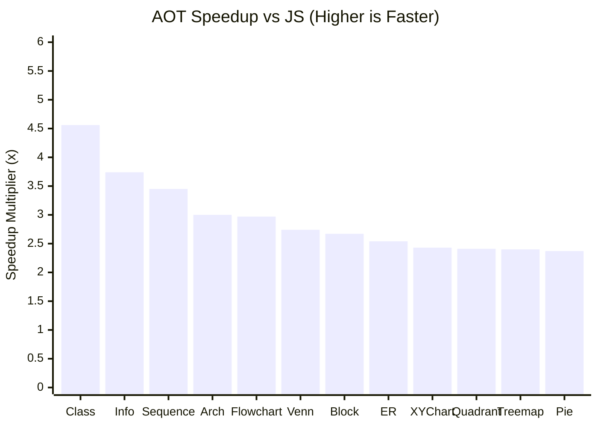
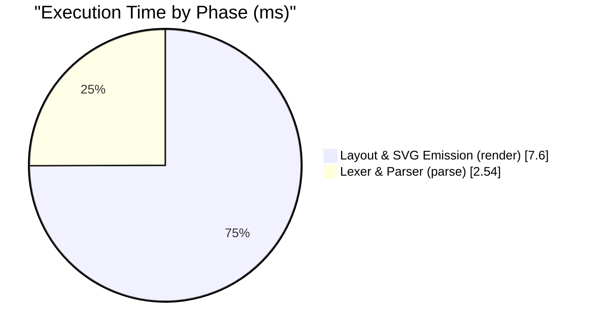

# Performance Benchmarks & Upstream Sync Regression Gate

This document reports the native **Dart AOT** rendering performance of `pele_dart` across all supported diagram families (`studio/diagrams/` gallery corpus) compared against upstream [`obsidianmd/pele`](https://github.com/obsidianmd/pele) (JavaScriptCore; see [`UPSTREAM.md`](../UPSTREAM.md) for the pinned upstream release).

> **Automated Release Gate:** This report and the baseline in [`tool/benchmark_baseline.json`](../tool/benchmark_baseline.json) are generated and verified by [`tool/benchmark_suite.dart`](../tool/benchmark_suite.dart). Every upstream sync must pass `dart run tool/benchmark_suite.dart --update-docs --check-regressions` on a quiescent machine (`1m loadavg <= 50%` of cores) before pinning [`UPSTREAM.md`](../UPSTREAM.md) or cutting a release.

### Benchmark Hardware & Runtime Environment

| Property | Specification |
| :--- | :--- |
| **Processor** | Apple M4 (10 logical cores) |
| **Memory & OS** | 32 GB RAM · macOS 15.6 (arm64) |
| **Dart Compiler** | Dart 3.13.7 (Native AOT executable) (`dart compile exe`) |
| **JavaScript Baseline** | WebKit JavaScriptCore (`jsc`) — `obsidianmd/pele` bundle |
| **Machine Load Condition** | Quiescent / idle (`1m loadavg < 5.0`; enforced automatically by `--update-docs`) |

---

## 1. Quick Commands

| Task | Command |
| :--- | :--- |
| **Run native AOT benchmark suite & print console table** | `dart run tool/benchmark_suite.dart` |
| **Update `doc/BENCHMARKS.md` and check for regressions (quiescent machine)** | `dart run tool/benchmark_suite.dart --update-docs --check-regressions` |
| **Update baseline after intentional optimizations (quiescent machine)** | `dart run tool/benchmark_suite.dart --update-docs --update-baseline` |
| **Emit machine-readable JSON for CI / agents** | `dart run tool/benchmark_suite.dart --json --check-regressions` |

---

## 2. Aggregate Corpus Summary

| Metric | `pele_dart` (Native Dart AOT) | `obsidianmd/pele` (JS) | Comparison |
| :--- | ---: | ---: | :--- |
| **Full Corpus Total (`SvgOutputMode.cssVariables`)** | **10.16 ms** | 21.94 ms | **2.16x faster overall** |
| **Mean Time per Diagram (`SvgOutputMode.cssVariables`)** | **43.8 µs** | 94.6 µs | **2.16x faster per diagram** |
| **Corpus Parse Phase Total (`parse()`)** | **2.54 ms** | — | 10.9 µs mean parse time |
| **Corpus Layout + SVG Render Phase Total (`render(model)`)** | **7.60 ms** | — | 32.8 µs mean layout + SVG time |
| **Mean Diagram Header Detection (`detectDiagram()`)** | **0.010 µs** | — | O(1) first-character switch dispatch (`< 0.05 µs`) |
| **Full Corpus Total (`SvgOutputMode.flattened`)** | **120.13 ms** | n/a *(CSS vars only)* | Includes static SVG 1.1 CSS-variable & `color-mix()` flattening |

### Visual Performance Comparisons

#### Core Mermaid Families — Mean Render Time (`pele_dart` AOT vs `obsidianmd/pele` JS)

> **Tall Background Bar (`bar` 1):** `obsidianmd/pele` JS (µs) &nbsp;|&nbsp; **Short Foreground Bar + Line (`bar` 2 / `line`):** `pele_dart` Native AOT (µs) — *Lower is faster*

```mermaid
xychart-beta
  title "Mean Render Time (µs — Lower is Faster)"
  x-axis ["Class", "ER", "Flowchart", "Gantt", "Git", "Info", "Mindmap", "Pie", "Sequence", "State"]
  y-axis "Mean Render Time (µs)" 0 --> 300
  bar [200.4, 102.3, 237.3, 88.3, 87.2, 4.8, 44.4, 31.5, 84.5, 142.9]
  bar [43.9, 40.2, 79.8, 65.9, 41.4, 1.3, 21.4, 13.3, 24.5, 62.0]
  line [43.9, 40.2, 79.8, 65.9, 41.4, 1.3, 21.4, 13.3, 24.5, 62.0]
```

#### Top 12 Diagram Families — Native Dart AOT Speedup Multiplier (`x` Faster than JS)

#### Full Corpus Execution Time Breakdown (`parse` vs `render`)

### Methodology Notes

1. **Always Benchmarked in Native Dart AOT (`dart compile exe`)**: Running in the Dart Debug/JIT VM includes unoptimized runtime type checks and interpreter warm-up. `tool/benchmark_suite.dart` automatically compiles itself to a native AOT executable before measuring any timings.
2. **Apples-to-Apples Output Mode (`SvgOutputMode.cssVariables`)**: Upstream `obsidianmd/pele` emits SVG styled with `var(--pele-*)` CSS custom properties. The head-to-head comparison measures `SvgOutputMode.cssVariables` in both engines using `metricsMeasurer`. `SvgOutputMode.flattened` (which resolves all CSS variables and `color-mix()` expressions into static SVG 1.1 attributes for `vector_graphics_compiler`) is reported in its own column.
3. **First-Visit Realistic Timing vs Loop-Specialized Tier-4 FTL JIT**: In JavaScriptCore (`jsc` / `WKWebView`), rendering a diagram 1–7 times (matching upstream `website/src/lib/timing.ts`) executes in `LLInt` / `Baseline` / `DFG` JIT (`21.94 ms` corpus total), where `pele_dart` AOT is **2.16x faster** because AOT machine code requires zero JIT warm-up. When a benchmark loop executes the exact same diagram thousands of times in a tight loop (`>= 1,000` iterations), JavaScriptCore compiles a Tier-4 FTL (`B3/Air`) loop specialization (`9.74 ms` corpus total).

---

## 3. Per-Family Benchmark & Phase Breakdown

| Diagram Family | Category | Samples | `parse()` (µs) | `render()` (µs) | `pele_dart` AOT (µs) | Flattened SVG (µs) | `obsidianmd/pele` JS (µs) | Speedup vs JS |
| :--- | :--- | ---: | ---: | ---: | ---: | ---: | ---: | ---: |
| **Class** (`class`) | Core | 8 | 8.8 | 34.3 | **43.9** | 531.8 | 200.4 | **4.56x** |
| **Entity relationship** (`er`) | Core | 8 | 9.3 | 30.5 | **40.2** | 556.3 | 102.3 | **2.54x** |
| **Flowchart** (`flowchart`) | Core | 8 | 16.4 | 66.2 | **79.8** | 471.4 | 237.3 | **2.97x** |
| **Gantt** (`gantt`) | Core | 8 | 11.1 | 53.9 | **65.9** | 441.0 | 88.3 | **1.34x** |
| **Git graph** (`git`) | Core | 8 | 12.4 | 28.5 | **41.4** | 676.2 | 87.2 | **2.11x** |
| **Info** (`info`) | Core | 5 | 0.5 | 0.8 | **1.3** | 42.1 | 4.8 | **3.74x** |
| **Mindmap** (`mindmap`) | Core | 8 | 2.8 | 18.5 | **21.4** | 442.3 | 44.4 | **2.08x** |
| **Pie** (`pie`) | Core | 4 | 4.3 | 8.8 | **13.3** | 240.8 | 31.5 | **2.37x** |
| **Sequence** (`sequence`) | Core | 8 | 6.9 | 17.5 | **24.5** | 467.2 | 84.5 | **3.45x** |
| **State** (`state`) | Core | 8 | 13.4 | 47.8 | **62.0** | 554.2 | 142.9 | **2.31x** |
| **Block** (`block`) | Extended | 8 | 6.7 | 15.4 | **22.3** | 313.0 | 59.8 | **2.67x** |
| **C4** (`c4`) | Extended | 7 | 24.5 | 75.4 | **100.5** | 1223.6 | 178.6 | **1.78x** |
| **Event modeling** (`eventmodeling`) | Extended | 8 | 8.8 | 19.2 | **28.2** | 615.4 | 51.6 | **1.83x** |
| **Kanban** (`kanban`) | Extended | 5 | 6.6 | 30.0 | **37.0** | 376.0 | 54.2 | **1.46x** |
| **Packet** (`packet`) | Extended | 6 | 5.7 | 9.5 | **15.4** | 306.8 | 31.3 | **2.03x** |
| **Quadrant chart** (`quadrant`) | Extended | 4 | 12.6 | 11.3 | **24.3** | 301.2 | 58.6 | **2.41x** |
| **Requirement** (`requirement`) | Extended | 8 | 9.0 | 33.6 | **43.2** | 736.1 | 75.2 | **1.74x** |
| **Sankey** (`sankey`) | Extended | 8 | 23.0 | 70.8 | **95.0** | 860.4 | 134.7 | **1.42x** |
| **Timeline** (`timeline`) | Extended | 8 | 3.7 | 32.6 | **36.2** | 618.1 | 57.7 | **1.59x** |
| **User journey** (`journey`) | Extended | 4 | 2.4 | 18.3 | **20.9** | 610.1 | 42.0 | **2.01x** |
| **XY chart** (`xychart`) | Extended | 8 | 5.9 | 19.0 | **25.1** | 355.9 | 61.2 | **2.43x** |
| **Agentflow** (`agentflow`) | Extended | 8 | 34.8 | 30.6 | **66.6** | 468.4 | 138.3 | **2.08x** |
| **Architecture** (`architecture`) | Extended | 8 | 11.6 | 17.2 | **30.0** | 724.4 | 89.8 | **3.00x** |
| **Cynefin** (`cynefin`) | Extended | 4 | 8.4 | 39.5 | **50.2** | 975.2 | 89.8 | **1.79x** |
| **Ishikawa** (`ishikawa`) | Extended | 4 | 2.5 | 15.8 | **18.3** | 386.4 | 33.3 | **1.82x** |
| **Radar** (`radar`) | Extended | 5 | 8.8 | 13.7 | **23.0** | 344.4 | 52.4 | **2.28x** |
| **Railroad** (`railroad`) | Extended | 8 | 15.8 | 38.9 | **57.5** | 808.4 | 77.6 | **1.35x** |
| **Swimlane** (`swimlane`) | Extended | 8 | 15.7 | 65.9 | **71.0** | 523.3 | 123.0 | **1.73x** |
| **Tree view** (`treeview`) | Extended | 8 | 9.0 | 7.5 | **16.8** | 299.8 | 38.1 | **2.26x** |
| **Treemap** (`treemap`) | Extended | 8 | 5.8 | 13.7 | **19.9** | 294.8 | 47.7 | **2.40x** |
| **Use case** (`usecase`) | Extended | 8 | 19.7 | 42.3 | **62.8** | 472.9 | 139.8 | **2.23x** |
| **Venn** (`venn`) | Extended | 8 | 3.4 | 80.6 | **83.8** | 266.7 | 229.3 | **2.74x** |
| **Wardley map** (`wardley`) | Extended | 8 | 12.3 | 17.4 | **30.6** | 483.7 | 54.0 | **1.77x** |

---

## 4. Upstream Sync Performance Invariants & Optimization Checklist

When syncing new upstream `obsidianmd/pele` commits (see [`doc/UPSTREAM_SYNC.md`](UPSTREAM_SYNC.md) and [`.agents/skills/sync-upstream-pele/SKILL.md`](../.agents/skills/sync-upstream-pele/SKILL.md)), newly ported TypeScript code can introduce Dart AOT regressions if JavaScript idioms (such as sticky/backtracking regex loops or per-character string allocations) are translated naively.

If `dart run tool/benchmark_suite.dart --check-regressions` flags a regression after porting upstream changes, inspect the reported phase (`PARSE` vs `RENDER`) against these core invariants:

1. **Diagram Detection ([`lib/src/detect.dart`](../lib/src/detect.dart))**:
   - Must remain `< 0.50 µs` (`O(1)` leading-whitespace skip + first-character `switch` dispatch returning `const Detected`). Never replace with a linear loop over a list of `RegExp` patterns.
2. **Lexer & Tokenization ([`lib/src/diagrams/common/tokens.dart`](../lib/src/diagrams/common/tokens.dart) & [`lib/src/diagrams/common/outline.dart`](../lib/src/diagrams/common/outline.dart))**:
   - `TokenType` retains its upstream `re: RegExp(...)` for 1:1 diffing, while `_prepare()` auto-compiles simple patterns into zero-allocation `codeUnitAt` matchers (`_compileFastMatcher`) and a first-character dispatch bitmask (`_inferFirstChars`).
   - If a newly synced diagram grammar introduces a complex hot-loop `TokenType`, provide an inline `match: (String input, int pos)` closure alongside `re:` if `_compileFastMatcher` cannot auto-specialize it.
3. **Text Measurement & Label Wrapping ([`lib/src/text/label.dart`](../lib/src/text/label.dart))**:
   - Preserve `_isSimpleWrapText` and `_splitSimplePieces` so standard non-CJK labels bypass `_rePiece` / `_reCjk` / `_reHint` regex matching, and use slice-based `StringBuffer.write(source.substring(start, end))` in `_inline` rather than per-character string concatenation.
4. **Date & Timezone Math ([`lib/src/diagrams/gantt/dates.dart`](../lib/src/diagrams/gantt/dates.dart))**:
   - In Dart AOT, `DateTime.timeZoneOffset` invokes an OS `localtime_r` syscall. Keep `_MDate._w` lazy and compute sub-minute fields (`getMilliseconds()`, `getUTCSeconds()`) directly from `millisecondsSinceEpoch`.
5. **YAML Frontmatter & Preprocessing ([`lib/src/preprocess.dart`](../lib/src/preprocess.dart) & [`lib/src/util/yaml.dart`](../lib/src/util/yaml.dart))**:
   - Use `codeUnitAt` scanning (`_stripCommentLines`, `_splitKey`, `_unquoteDouble`) and pre-accumulate multiline quoted scalars before parsing rather than using control-flow exceptions.
