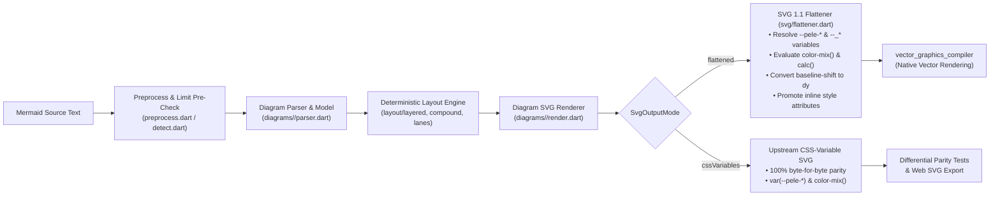

# `pele_dart` Architecture, Development & Maintenance Design Document

* **Status**: Implemented (Version-Locked 1:1 to Upstream `obsidianmd/pele` per [`UPSTREAM.md`](../UPSTREAM.md), All 33 Diagram Families Ported with 100% `787/787` Upstream Parity)
* **Current Public API Reference**: See [`docs/API_MANUAL.md`](API_MANUAL.md) for the final 1:1 `obsidianmd/pele`-aligned API (`render`, `renderMermaid`, `parse`, `detectType`, `supports`, `RenderOptions`, `ParseOptions`, `RenderResult`, `PeleError`, `PelePalette`, `SvgOutputMode`)
* **Upstream Tracking**: See [`UPSTREAM.md`](../UPSTREAM.md) (Single source of truth for the pinned [`obsidianmd/pele`](https://github.com/obsidianmd/pele) release and commit SHA) and [`docs/UPSTREAM_SYNC.md`](UPSTREAM_SYNC.md)
* **Target SDK**: Pure Dart `^3.13.0` (Zero Flutter / `dart:ui` / Browser / JS Runtime dependencies in the core package)

---

## 1. Executive Summary & Goals

Traditional Mermaid diagram rendering in Dart and Flutter applications requires running a multi-megabyte JavaScript bundle (`mermaid.min.js`) inside an offscreen browser engine (`WKWebView`, `WebKitGTK`, or `WebView2`) and executing complex DOM-inspection scripts (`getComputedStyle()`, `getPointAtLength()`, `<canvas>` rasterization) because Flutter’s `vector_graphics_compiler` and `flutter_svg` only support a static subset of SVG primitives.

**`pele_dart`** eliminates the browser and JavaScript runtime entirely by providing a **pure Dart 3 library** ported 1:1 from [`obsidianmd/pele`](https://github.com/obsidianmd/pele)—Obsidian’s zero-dependency, synchronous, zero-DOM Mermaid rendering engine—augmented with a native **flattened SVG emitter** that outputs `vector_graphics_compiler`-ready SVG directly, plus a **macOS 3-way visual and SVG diff workbench (`studio/`)** for human verification against upstream `obsidianmd/pele` and `mermaid.js`.

### 1.1 Primary Goals

1. **Zero Browser & Zero JS Engine**: Render Mermaid diagrams into SVG synchronously in pure Dart with no WebView process, no embedded JS engine (`QuickJS` / `JavaScriptCore`), and no DOM dependency.
2. **Pure Dart Core (`sdk: ^3.13.0`)**: Depend only on standard Dart core libraries and `package:meta`, enabling execution inside background Dart isolates (`Isolate.run`), CLI tools, servers, and unit tests without a Flutter runtime.
3. **Dual SVG Output Modes**:
   * **`SvgOutputMode.flattened`** *(Default for Native Vector Rendering)*: Directly emits pre-flattened SVG primitives compatible with `vector_graphics_compiler` (`encodeSvg`), eliminating the need for a post-render DOM flattener or a raster PNG `<canvas>` fallback.
   * **`SvgOutputMode.cssVariables`** *(Upstream Parity Mode)*: Emits byte-for-byte structurally identical SVG to upstream `obsidianmd/pele` (`var(--pele-*)` CSS custom properties, `<style>`, `<marker>` arrowheads, `dominant-baseline`) for differential testing against upstream Pele and standalone `.svg` file export.
4. **Full Diagram Coverage**: Support all 33 diagram families present in `obsidianmd/pele` (recorded in [`UPSTREAM.md`](../UPSTREAM.md)).
5. **macOS 3-Way Comparison & SVG Diff Workbench (`studio/`)**: Provide a macOS desktop application to visually compare and inspect/diff the raw SVG output of any diagram across **`pele_dart`**, **`obsidianmd/pele` (JS)**, and **`mermaid.js`** in 1-way, 2-way, or 3-way views.
6. **First-Class Upstream Syncability**: Maintain a strict 1:1 file and symbol mapping with `obsidianmd/pele/src/`, using [`UPSTREAM.md`](../UPSTREAM.md) as the single source of truth for the pinned upstream commit so future upstream commits and releases can be diffed and ported mechanically.
7. **Defense-in-Depth DoS Safety Caps**: Enforce fine-grained pre-parse and post-parse resource budgets (source length, node/edge counts, subgraph depth, element count, path length, and dash segment budgets).

### 1.2 Non-Goals

* **DOM / HTML Label Execution**: Like upstream Pele, `pele_dart` never executes `<script>`, JS callbacks, or arbitrary HTML `<foreignObject>` trees.
* **Mermaid ELK Layout Engine Emulation**: `pele_dart` uses Pele’s deterministic layered/compound/lane layout solvers (`lib/src/layout/`) rather than bundling `elkjs`.
* **Flutter Widget Rendering Inside the Core Package**: The root `pele_dart` package outputs SVG strings, logical dimensions, accessibility metadata, and structured diagnostics; Flutter widget rendering lives only in downstream consumers and in the `studio/` macOS comparison app.

---

## 2. Public API Design

The library exposes synchronous functions (`render`, `renderMermaid`, `parse`, `detectType`, `supports`, `flattenPeleSvg`, `register`, `registered`, `forgetTextWidths`) designed to run either on the main isolate or inside `Isolate.run()`, returning a [`RenderResult`](../lib/src/types.dart) (with `svg`, `width`, `height`, `type`, `mermaidType`, and `links`) or throwing a structured [`PeleError`](../lib/src/errors.dart) (`code`: `'syntax'`, `'semantic'`, `'unsupported-diagram'`, or `'limit'`).

```dart
/// Output format for the generated SVG string.
enum SvgOutputMode {
  /// Emits static SVG 1.1 primitives compatible with `vector_graphics_compiler`
  /// (resolved `#rrggbb` palette colors, `color-mix()` blends, `calc()` math,
  /// `currentColor`, `<tspan>` `dy` baseline offsets, and promoted SVG attributes).
  flattened,

  /// Emits upstream-compatible themeable SVG using `var(--pele-*)` CSS variables
  /// and `color-mix(in srgb, ...)`.
  cssVariables,
}

/// Concrete color and typography palette mapped to `--pele-*` theme variables.
class PelePalette {
  const PelePalette({
    required this.bg,
    required this.fg,
    this.muted,
    this.line,
    this.surface,
    required this.surfaceAlt,
    this.border,
    this.accent,
    this.code,
    required this.critical,
    this.fgOnLight,
    this.fgOnDark,
    this.radius = 6,
    this.strokeWidth = 1.25,
    this.thickStrokeWidth = 2.5,
    this.hairlineStrokeWidth = 0.5,
    this.fontFamily =
        '-apple-system, BlinkMacSystemFont, "Segoe UI", Roboto, Helvetica, Arial, sans-serif',
    this.monoFontFamily =
        'ui-monospace, SFMono-Regular, "SF Mono", Menlo, Consolas, monospace',
    this.colors = const <String>[
      '#4c78a8',
      '#f58518',
      '#54a24b',
      '#e45756',
      '#72b7b2',
      '#eeca3b',
      '#b279a2',
      '#9d755d',
    ],
  });

  /// Built-in default light palette matching Pele's light defaults.
  static const PelePalette light = PelePalette(
    bg: '#ffffff',
    fg: '#24292e',
    surfaceAlt: '#e6e6e6',
    critical: '#e45756',
  );

  /// Built-in default dark palette matching Pele's dark defaults.
  static const PelePalette dark = PelePalette(
    bg: '#1e1e1e',
    fg: '#e1e4e8',
    surfaceAlt: '#3f3f46',
    critical: '#f87171',
  );
}

/// Configuration for a `render()` or `renderMermaid()` invocation.
class RenderOptions {
  const RenderOptions({
    this.measurer,
    this.fontFamily,
    this.fontFamilyMono,
    this.monospace,
    this.fontSize,
    this.idPrefix,
    this.responsive,
    this.maxWidth,
    this.autoDirection,
    this.directionBreakpoint,
    this.padding,
    this.limit,
    this.outputLimit,
    this.maxEdges,
    this.linkSchemes,
    this.imageSchemes,
    this.links,
    this.images,
    this.linkRel,
    this.icons,
    this.math,
    this.config,
    this.now,
    this.outputMode = SvgOutputMode.flattened,
    this.palette = PelePalette.light,
  });
}

/// Renders Mermaid [source] (`String` or pre-parsed model from `parse()`) into a [RenderResult].
RenderResult render(
  Object source, [
  RenderOptions options = const RenderOptions(),
]);

/// Convenience helper returning `render(source, options).svg`.
String renderMermaid(
  String source, {
  RenderOptions options = const RenderOptions(),
});
```

---

## 3. System Architecture & 1:1 Upstream Mapping

### 3.1 Rendering Pipeline



### 3.2 Directory Layout (`1:1` with `obsidianmd/pele`)

Every file in `obsidianmd/pele/src/` maps directly to `lib/src/` in `pele_dart`, while `example/` houses the pure-Dart CLI example for `pub.dev` and `studio/` houses the macOS 3-way visual and SVG diff comparison application:

```text
pele_dart/
├── AGENTS.md                        # AI agent constitution & architectural invariants
├── UPSTREAM.md                      # Single source of truth for pinned upstream SHA & sync matrix
├── pubspec.yaml                     # Pure Dart package manifest (single source of truth for package version)
├── analysis_options.yaml            # Strict analyzer & lint rules
├── docs/
│   ├── API_MANUAL.md                # Complete API reference & integration guide
│   ├── DIAGRAM_GALLERY.md           # Standalone pure-Dart SVG gallery for all 33 diagram families
│   ├── UPSTREAM_SYNC.md             # Upstream release detection, sync & verification guide
│   ├── DESIGN.md                    # This design document
│   └── images/                      # Standalone SVG renders (diagrams/*.svg, styles/*.svg)
├── lib/
│   ├── pele_dart.dart               # Public library entrypoint
│   └── src/
│       ├── core.dart                # <- src/core.ts
│       ├── detect.dart              # <- src/detect.ts
│       ├── errors.dart              # <- src/errors.ts
│       ├── index.dart               # <- src/index.ts
│       ├── preprocess.dart          # <- src/preprocess.ts
│       ├── types.dart               # <- src/types.ts
│       ├── util/
│       │   ├── chars.dart           # <- src/util/chars.ts
│       │   ├── math_js.dart         # Dart helpers for JS 32-bit bitwise/slice semantics
│       │   ├── unicode.dart         # <- src/util/unicode.ts
│       │   ├── url.dart             # <- src/util/url.ts
│       │   └── yaml.dart            # <- src/util/yaml.ts
│       ├── text/
│       │   ├── entities.dart        # <- src/text/entities.ts
│       │   ├── icons.dart           # <- src/text/icons.ts
│       │   ├── label.dart           # <- src/text/label.ts
│       │   ├── math.dart            # <- src/text/math.ts (TeX math layout to SVG)
│       │   ├── measurer.dart        # <- src/text/measurer.ts
│       │   └── metrics.dart         # <- src/text/metrics.ts
│       ├── layout/
│       │   ├── components.dart      # <- src/layout/components.ts
│       │   ├── compound.dart        # <- src/layout/compound.ts
│       │   ├── lanes.dart           # <- src/layout/lanes.ts
│       │   └── layered.dart         # <- src/layout/layered.ts
│       ├── svg/
│       │   ├── builder.dart         # <- src/svg/builder.ts
│       │   ├── cluster.dart         # <- src/svg/cluster.ts
│       │   ├── edges.dart           # <- src/svg/edges.ts
│       │   ├── flattener.dart       # SVG 1.1 palette/CSS resolver & baseline normalizer
│       │   ├── ink.dart             # <- src/svg/ink.ts
│       │   ├── palette.dart         # <- src/svg/palette.ts
│       │   ├── root.dart            # <- src/svg/root.ts
│       │   ├── shapes.dart          # <- src/svg/shapes.ts
│       │   ├── theme.dart           # <- src/svg/theme.ts
│       │   └── title.dart           # <- src/svg/title.ts
│       └── diagrams/
│           ├── registry.dart        # <- src/diagrams/registry.ts
│           ├── common/              # <- src/diagrams/common/
│           ├── flowchart/           # <- src/diagrams/flowchart/
│           ├── sequence/            # <- src/diagrams/sequence/
│           └── ... (all 33 diagram directories)
├── test/
│   ├── core_test.dart               # Core detection, preprocessing, layout & API tests
│   ├── gallery_corpus_test.dart     # 232 gallery & 522 upstream corpus parity + encodeSvg tests
│   └── diagrams/                    # Per-diagram unit & vector_graphics_compiler tests
├── tool/
│   ├── sync_upstream.dart           # Reads UPSTREAM.md, diffs obsidianmd/pele & refreshes assets
│   ├── verify_against_upstream.dart # 787-diagram differential test runner (Bun Pele vs. pele_dart)
│   └── generate_doc_images.dart     # Generates docs/images/**/*.svg and docs/DIAGRAM_GALLERY.md
├── example/
│   ├── main.dart                    # Standalone pure-Dart CLI example (for pub.dev)
│   └── README.md                    # Pure-Dart usage examples for pub.dev's Example tab
└── studio/
    ├── pubspec.yaml                 # macOS Flutter Comparison Studio manifest
    ├── diagrams/                    # File-based .mmd/.mermaid gallery (01_core, 02_extended, 03_custom)
    ├── macos/
    └── lib/
        ├── main.dart                # macOS 3-Way Comparison Studio UI, visual diff & SVG diff views
        ├── engine_runner.dart       # Adapters for pele_dart, obsidianmd/pele (JS), and mermaid.js
        └── gallery_samples.dart     # File-system .mmd/.mermaid scanner & corpus loader
```

---

## 4. Solving the `vector_graphics_compiler` Gap Without a Browser

In `mermaid.js`, diagram renderers mutate a live DOM in arbitrary ways (injecting CSS stylesheets, `<foreignObject>` HTML tables, D3 markers, and nested `<svg>` viewports), which requires querying `window.getComputedStyle()` and `SVGPathElement.getPointAtLength()` in a headless browser to flatten the DOM into static SVG primitives.

In contrast, **upstream `obsidianmd/pele` already emits clean, self-contained SVG geometry without `<marker>` definitions or `<foreignObject>` layout tables**. The remaining incompatibilities with `vector_graphics_compiler` and static SVG 1.1 renderers are CSS custom properties (`var(--pele-*)`, `var(--_*)`), CSS Color 5 `color-mix(in srgb, ...)`, `calc(...)`, `currentColor`, `<tspan>` `baseline-shift="sub|super"`, and inline `style="..."` properties.

`lib/src/svg/flattener.dart` (`flattenPeleSvg`) resolves all of these deterministically in pure Dart while keeping the 33 diagram renderers 100% 1:1 with upstream `obsidianmd/pele`:

| Upstream Pele Construct | Why `vector_graphics_compiler` Rejects It | How `pele_dart` (`SvgOutputMode.flattened`) Resolves It in `svg/flattener.dart` |
| :--- | :--- | :--- |
| **`var(--pele-*)`, `var(--_*)` & `color-mix(in srgb, ...)`** | Compiler only parses literal hex (`#rrggbb`), `rgb(...)`, or named SVG colors; CSS variables and `color-mix(in srgb, ...)` fail parsing. | `flattenPeleSvg` evaluates all `--pele-*` and scope-inherited `--_*` variable bindings plus nested `color-mix(in srgb, ...)` sRGB blends in Dart against `PelePalette`, emitting concrete `#rrggbb` / `rgba(...)` values. |
| **`calc(...)` & `currentColor`** | Compiler requires numeric length attributes and explicit color values. | `flattenPeleSvg` evaluates `calc(...)` arithmetic expressions to numbers and replaces `currentColor` with the resolved foreground color (`--_fg`). |
| **Inline `style="..."` presentation & geometry properties** | Compiler ignores CSS geometry properties (`rx`, `ry`) and certain presentation properties when only specified inside `style="..."`. | `flattenPeleSvg` promotes inline `style="..."` properties (`rx`, `ry`, `fill`, `stroke`, `stroke-width`, `stroke-dasharray`, `opacity`, `font-size`, etc.) to native SVG 1.1 XML attributes and attaches `font-family` and `font-size` to the root `<svg>`. |
| **`<tspan baseline-shift="sub\|super" font-size="smaller">`** | Compiler ignores `baseline-shift` and relative keyword `font-size="smaller"`. | `flattenPeleSvg` converts `baseline-shift="sub\|super" font-size="smaller"` on `<tspan>` elements into explicit `dy="3"` / `dy="-4"` vertical offsets (with reset `dy` on following sibling `<tspan>`s) and numeric `font-size="10"`. |

Because all 33 diagram families in Pele emit their output through `src/svg/`, **every diagram type compiles to native lossless `vector_graphics` without needing a raster PNG fallback**.

---

## 5. TypeScript-to-Dart Translation Rules & Pitfalls

Because `obsidianmd/pele` is written in dependency-free strict TypeScript with zero DOM calls, ~95% of the code translates 1:1 into Dart 3. The remaining 5% involves subtle runtime differences between JavaScript (V8) and the Dart VM / AOT compiler that **must** be standardized in `lib/src/util/math_js.dart` so layout coordinates match upstream:

1. **64-Bit Dart `int` vs. JS 32-Bit Signed Bitwise Operations**:
   * In JavaScript, `x | 0`, `x & y`, `x ^ y`, `x << n`, `x >> n`, and `Math.imul(a, b)` coerce operands to 32-bit signed integers (`Int32`), and `x >>> n` coerces to 32-bit unsigned (`Uint32`).
   * In Dart, `int` is a 64-bit signed integer. Any hash function, deterministic seed, or bitset in Pele that uses bitwise operators will produce different numbers in Dart unless wrapped in `imul32(a, b)`, `shl32(a, n)`, `shr32(a, n)`, `ushr32(a, n)`, and `(x).toSigned(32)`.
2. **Number-to-String Formatting in SVG Attributes**:
   * In JavaScript, `Number(12.0).toString()` produces `"12"`, whereas in Dart `(12.0).toString()` produces `"12.0"`.
   * Provide a single `fmtNum(num value)` helper in `lib/src/svg/builder.dart` that rounds to 3 decimal places, strips trailing `.0` / zeros, converts `-0` to `0`, and formats without scientific notation (`1e-5`), ensuring byte-for-byte SVG coordinate parity with upstream Pele in `SvgOutputMode.cssVariables`.
3. **Out-of-Bounds & Negative Slicing (`slice` vs. `sublist` / `substring`)**:
   * JavaScript’s `Array.slice(start, end)` and `String.slice(start, end)` accept negative indices and silently clamp indices beyond `length`. Dart’s `List.sublist` and `String.substring` throw `RangeError`.
   * Provide `List<T>.jsSlice(int start, [int? end])` and `String.jsSlice(int start, [int? end])` extension methods in `lib/src/util/math_js.dart`.
4. **JavaScript Truthiness & `NaN` Checks**:
   * In JS, `Number.parseFloat("abc")` returns `NaN`, and `val || defaultVal` treats `0`, `""`, and `NaN` as falsy.
   * In Dart, `double.tryParse("abc")` returns `null`. When translating `const w = Number(raw) || 100`, translate explicitly as:
     ```dart
     final parsed = double.tryParse(raw);
     final w = (parsed != null && parsed.isFinite && parsed != 0.0) ? parsed : 100.0;
     ```
5. **Regular Expressions (`RegExp`)**:
   * Replace JS sticky regexes (`/pattern/y` with `lastIndex`) using Dart’s `regExp.matchAsPrefix(source, index)`.
   * Ensure JS `/i` and `/m` flags map to `caseSensitive: false` and `multiLine: true`.

---

## 6. macOS 3-Way Gallery & Comparison Demo App (`studio/`)

To allow human developers to visually vet diagram fidelity and inspect/diff raw SVG markup across engines, `pele_dart` includes a **macOS-only Flutter desktop application** under `studio/` (no iOS, Android, Windows, Linux, or Web targets in `studio/`).

### 6.1 The Three Renderers

For any selected diagram, the workbench can run all three engines in parallel:
1. **`pele_dart` (Native Dart)**:
   * Renders synchronously in Dart and compiles `SvgOutputMode.flattened` via `vector_graphics_compiler` + `vector_graphics`.
   * Also renders `SvgOutputMode.cssVariables` so you can compare `pele_dart`’s CSS-variable SVG directly against upstream `obsidianmd/pele`’s SVG.
2. **`obsidianmd/pele` (Upstream JS)**:
   * Runs the pinned upstream `pele` JS bundle inside a macOS `WKWebView` (or headless runner) to display upstream Pele’s reference rendering and capture its raw SVG string.
3. **`mermaid.js` (Official Reference JS)**:
   * Runs official `mermaid.min.js` inside a macOS `WKWebView` to display standard Mermaid’s layout/rendering and capture its DOM-serialized SVG string.

### 6.2 Flexible 1-Way, 2-Way, and 3-Way Comparison Modes

A toolbar toggle lets you choose which renderers are active:
* **1-Way (Single Renderer)**: View any single renderer (`pele_dart`, `obsidianmd/pele` JS, or `mermaid.js`) full-window.
* **2-Way Side-by-Side**: Pick any pair:
  * `pele_dart` vs. `obsidianmd/pele` (JS) — *Verifies exact port parity between Dart and TypeScript.*
  * `pele_dart` vs. `mermaid.js` — *Compares Pele’s layout and styling against classic Mermaid.*
  * `obsidianmd/pele` (JS) vs. `mermaid.js` — *Isolates upstream Pele design differences from Dart porting bugs.*
* **3-Way Side-by-Side**: View all three (`pele_dart` | `obsidianmd/pele` JS | `mermaid.js`) simultaneously.

### 6.3 Visual Render, Visual Graphic Diff, Raw SVG Markup, and SVG Text Diff Modes

The workbench provides four complementary inspection modes for the active renderer(s):

1. **Visual Render View (Side-by-Side)**:
   * Synchronized pan & zoom (`InteractiveViewer` with linked `TransformationController`s so zooming in on a node or arrowhead zooms all active panes to the same region).
   * Light / Dark theme toggle.
   * Header telemetry pills showing render duration (`ms`), `viewBox` dimensions (`W × H`), and SVG byte/element counts for each engine.
2. **Visual Graphic Diff View (Overlay Comparison of Any 2 Renderers)**:
   * Compares the rendered graphics of any two selected engines (e.g., `pele_dart` vs. `obsidianmd/pele` JS, or `pele_dart` vs. `mermaid.js`) inside a single locked pan/zoom viewport with four sub-modes:
     * **Split-Curtain (Swipe Slider)**: Stacks Renderer A and Renderer B in the same coordinate space with a draggable vertical divider (`ClipRect`) to wipe seamlessly across the diagram.
     * **Cyan / Magenta Channel Overlay**: Tints Renderer A in **Cyan** and Renderer B in **Magenta** via GPU `ColorFiltered` + `BlendMode.multiply` (light mode) / `BlendMode.screen` (dark mode). Identical overlapping geometry blends to neutral gray/black, while any shifted edge, arrowhead, or label glows bright **Cyan** (only in A) or **Magenta** (only in B) at full 60/120 fps.
     * **Pixel-Diff Heatmap & Match Score**: Rasterizes both renders to `2x`/`3x` RGBA `ByteData` buffers at identical logical scale and computes a pixel-by-pixel diff in a background `Isolate`, dimming matching pixels to a faint 15%-opacity context layer, highlighting differing pixels in bright red, and displaying a `% pixel match` badge in the toolbar.
     * **In-Place Blink / Onion-Skin**: Press `Space` (or use an auto-blink toggle / opacity cross-fade slider) to flip between Renderer A and Renderer B in place so subtle layout shifts pop out immediately.
3. **Raw SVG Output View**:
   * Displays the **pretty-printed, syntax-highlighted SVG XML text** side-by-side (or single-pane) for each active renderer.
   * For `pele_dart`, includes a toggle to inspect either the **`flattened` SVG** (what `vector_graphics_compiler` consumes) or the **`cssVariables` SVG** (upstream parity output).
   * Includes search/filter within the SVG markup and one-click **"Copy SVG"**.
4. **SVG Text Diff View (Built-in + External Diff Tool Launcher)**:
   * **Built-in Normalized SVG Diff**: Normalizes and pretty-prints the SVG XML from any two selected sources (e.g., `pele_dart (cssVariables)` vs. `obsidianmd/pele (JS)`, or `pele_dart (flattened)` vs. `pele_dart (cssVariables)`) with deterministic attribute ordering and one element per line, rendering an inline unified/split text diff with green/red line highlights and a diff count badge (`0 differences` when byte-identical).
   * **"Open in External Diff Tool" Button**: Writes the two selected pretty-printed SVG outputs to temporary `.svg` files in `Directory.systemTemp` and invokes an external macOS diff tool (`opendiff` / Xcode FileMerge, `code --diff`, `ksdiff`, `bcomp`, or a user-configured CLI command) for deep structural diffing.

### 6.4 Curated 33-Diagram Gallery & Scratchpad Editor
* **Left Sidebar Gallery**: Categorized tree of all 33 diagram families with multiple test cases per family (basic, complex routing, subgraphs, styling/theming, edge cases) plus pass/diff status badges.
* **Collapsible Live Source Editor**: Edit any gallery fixture or paste custom Mermaid syntax to see all active renderers and SVG diffs update in real time.

---

## 7. Phased Development & Verification Plan

### Phase 0: Repository & Verification Harness
* Finalize `docs/DESIGN.md`, `AGENTS.md`, `UPSTREAM.md`, and `pubspec.yaml`.
* Build `tool/verify_against_upstream.dart`: a CLI verification script that reads the pinned commit SHA from [`UPSTREAM.md`](../UPSTREAM.md), checks out `obsidianmd/pele` at that commit into `.upstream/` (gitignored), runs Node on upstream `pele.render(code)` and Dart on `pele_dart`'s `renderMermaid(code)`, and verifies:
  1. **Parity check (`SvgOutputMode.cssVariables`)**: Normalized SVG XML/AST comparison against upstream Pele.
  2. **Vector compiler check (`SvgOutputMode.flattened`)**: Compiles the flattened SVG using `package:vector_graphics_compiler` (`encodeSvg`) and asserts zero errors.

### Phase 1: Shared Core Infrastructure (~25 files)
Port and unit-test the foundation modules in dependency order:
1. `lib/src/types.dart`, `lib/src/errors.dart`
2. `lib/src/util/` (`math_js.dart`, `chars.dart`, `unicode.dart`, `url.dart`, `yaml.dart`)
3. `lib/src/text/` (`entities.dart`, `metrics.dart`, `measurer.dart`, `label.dart`, `icons.dart`, `math.dart`)
4. `lib/src/layout/` (`components.dart`, `lanes.dart`, `layered.dart`, `compound.dart`)
5. `lib/src/svg/` (`palette.dart`, `ink.dart`, `theme.dart`, `builder.dart`, `shapes.dart`, `edges.dart`, `cluster.dart`, `title.dart`, `root.dart`, `flattener.dart`)
6. `lib/src/preprocess.dart`, `lib/src/detect.dart`, `lib/src/core.dart`, `lib/src/diagrams/common/`, `lib/src/diagrams/registry.dart`

### Phase 2: Tier-1 Diagrams (9 Diagram Families) + macOS 3-Way Comparison App (`studio/`)
* Port the 9 highest-usage diagram types and their upstream `tests/compat/` and `tests/render/` test suites:
  * `flowchart`, `sequence`, `class`, `state`, `er`, `gantt`, `git`, `mindmap`, `pie`
* Build the `studio/` macOS 3-Way Gallery & SVG Diff Workbench so every ported diagram can be visually and structurally compared against `obsidianmd/pele` (JS) and `mermaid.js`.

### Phase 3: Tier-2 Diagrams (Remaining 24 Diagram Families)
Because Phase 1’s core is frozen and every diagram module under `lib/src/diagrams/<type>/` is hermetically isolated, port the remaining 24 diagram families in parallel batches:
* **Batch A (Architecture & Systems)**: `architecture`, `c4`, `block`, `packet`, `requirement`, `usecase`
* **Batch B (Process & Flows)**: `agentflow`, `eventmodeling`, `journey`, `kanban`, `railroad`, `swimlane`, `timeline`
* **Batch C (Data & Charts)**: `quadrant`, `radar`, `sankey`, `treemap`, `treeview`, `venn`, `xychart`
* **Batch D (Strategy & Misc)**: `cynefin`, `ishikawa`, `wardley`, `info`

---

## 8. Upstream Maintenance & Sync Lifecycle

Because `obsidianmd/pele` is actively evolving, `pele_dart` is designed from day one for **low-friction, automated upstream synchronization** with a **single source of truth** for the upstream pin.

### 8.1 Single Source of Truth ([`UPSTREAM.md`](../UPSTREAM.md)) & Static File Headers
* **The pinned upstream release tag and commit SHA live exclusively in [`UPSTREAM.md`](../UPSTREAM.md)**. They are never duplicated in Dart constants or per-file comments.
* Every Dart file under `lib/src/` carries a static path comment on line 1 mapping it to its upstream TypeScript file (without a commit SHA suffix that would go stale on every sync):
  ```dart
  // Upstream: src/diagrams/flowchart/layout.ts
  ```

### 8.2 Automated Upstream Sync Tool (`tool/sync_upstream.dart`)
When a new version of `obsidianmd/pele` is released (e.g., `v1.14.0`), running:
```bash
dart run tool/sync_upstream.dart --update-to v1.14.0
```
(or `dart run tool/sync_upstream.dart --update-to-latest`) performs the following automated workflow:
1. Reads the currently pinned `Target Commit SHA` directly from [`UPSTREAM.md`](../UPSTREAM.md) (`<old-sha>`).
2. Fetches the latest commits/tags from `https://github.com/obsidianmd/pele` into `.upstream/`.
3. Runs `git -C .upstream diff --name-status <old-sha>..<target-sha> -- src/ tests/`.
4. Maps every changed upstream TypeScript file (`src/diagrams/sequence/parser.ts`) to its exact Dart counterpart (`lib/src/diagrams/sequence/parser.dart`).
5. Emits a structured **Sync Report & Task Breakdown** (`.upstream/diff_report.md`) containing:
   * Newly added files, modified files, and deleted files grouped by module (`core`, `layout`, `svg`, or `diagrams/<type>`).
   * The exact per-file unified diff (`git diff <old-sha>..<target-sha> -- <file>`) ready to be translated into Dart.

### 8.3 Differential Regression Gate
After applying an upstream diff to `lib/src/<module>/`:
1. Run `dart run tool/verify_against_upstream.dart` to verify that `pele_dart` in `SvgOutputMode.cssVariables` matches the new upstream `obsidianmd/pele` output byte-for-byte across all 787 canonical, gallery, and corpus fixtures.
2. Run `dart test` to verify that `SvgOutputMode.flattened` compiles every fixture cleanly through `vector_graphics_compiler`.
3. Update the `Target Release`, `Target Commit SHA`, and module status table in [`UPSTREAM.md`](../UPSTREAM.md) via `dart run tool/sync_upstream.dart --pin <tag> <sha>`.

---

## 9. Agentic Coding Architecture & Considerations

Because `pele_dart` will be built and maintained heavily by AI coding agents, the repository is structured specifically to maximize agent accuracy, parallelism, and self-verification:

### 9.1 `AGENTS.md` as the Enforced Contract
* [`AGENTS.md`](../AGENTS.md) at the repository root is kept concise, prescriptive, and always loaded into agent context.
* It codifies the **4 non-negotiable invariants**:
  1. 1:1 upstream file/symbol parity (`src/<path>.ts` ↔ `lib/src/<path>.dart`) with [`UPSTREAM.md`](../UPSTREAM.md) as the single source of truth for the upstream pin.
  2. Hermetic isolation between `lib/src/diagrams/<type>/` directories.
  3. Dual SVG emission (`SvgOutputMode.flattened` + `SvgOutputMode.cssVariables`).
  4. Strict TypeScript-to-Dart semantic helpers (`math_js.dart` 32-bit bitwise ops, `jsSlice`, `fmtNum`).

### 9.2 Hermetic Boundaries for Multi-Agent Parallelism
* A common failure mode when running multiple agents in parallel is merge conflicts in shared files (such as `registry.dart`, `pubspec.yaml`, or barrel exports).
* To prevent this:
  * During **Phase 1**, `lib/src/diagrams/registry.dart` and all 33 directory stubs (`lib/src/diagrams/<type>/`) are pre-created and registered once.
  * During **Phase 2 and Phase 3**, each parallel agent task is scoped strictly to **one diagram directory**: `lib/src/diagrams/<type>/` and `test/diagrams/<type>_test.dart`.
  * Because no diagram directory touches any file outside `lib/src/diagrams/<type>/` and `test/diagrams/<type>_test.dart`, multiple agents can port different diagram families simultaneously on separate git worktrees or branches with **zero merge conflicts**.

### 9.3 Self-Contained Agent Verification Loop
Agents perform best when they have a fast, deterministic oracle that tells them *why* a port differs from upstream. We provide two fast CLI tools for agents:
1. **`dart run tool/verify_against_upstream.dart`**:
   * Runs all 787 canonical, gallery, and test corpus diagrams through both upstream `obsidianmd/pele` (in `.upstream/` at the SHA parsed from `UPSTREAM.md`) and `pele_dart`, reporting any SVG mismatch if the Dart port diverges from TypeScript.
2. **`dart test test/diagrams/<type>_test.dart`**:
   * Runs the ported unit tests **and** passes every generated flattened SVG through `vector_graphics_compiler.encodeSvg()` in under 2 seconds, catching any unsupported SVG attribute or malformed path data immediately.

### 9.4 Commit Hygiene & Issue-First Workflow
* All porting phases and upstream syncs are tracked via GitHub Issues on `tkinnis/pele_dart`.
* Every commit must pass `dart analyze --fatal-infos`, `dart test`, and `dart format --set-exit-if-changed`, follow **Conventional Commits** (`feat(flowchart): port flowchart parser, layout, and renderer`), and strictly adhere to the **NO AI references** policy.
