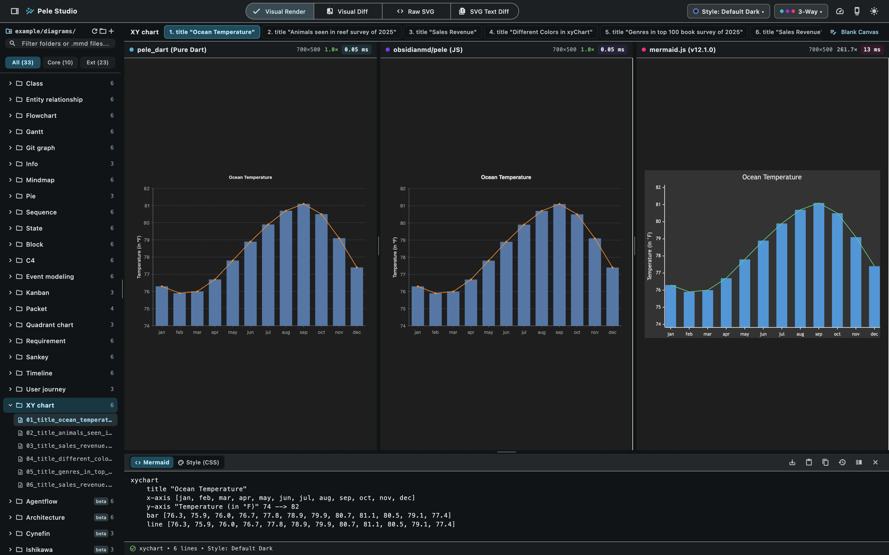
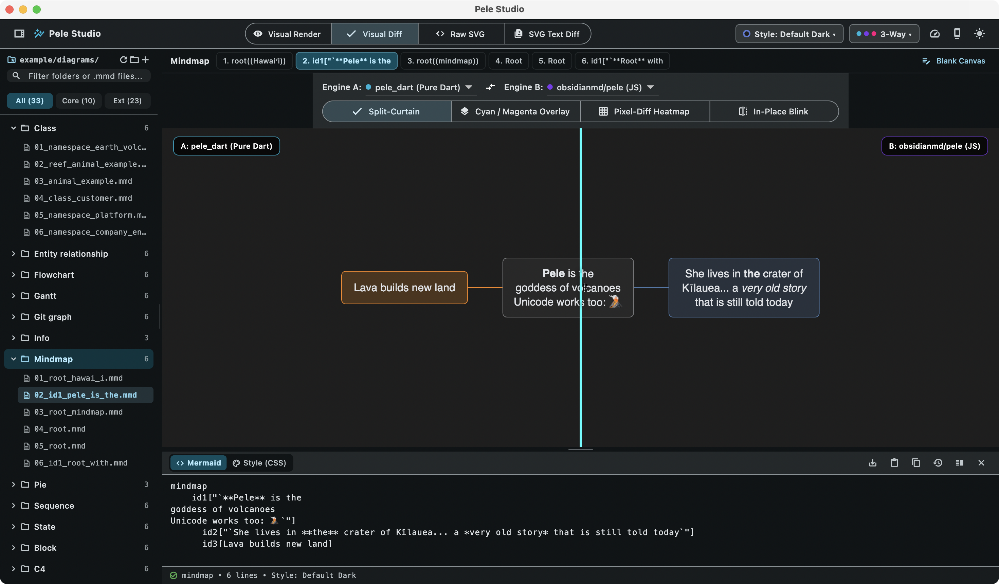

# Pele Studio — macOS 3-Way Comparison & Visual Diff Workbench

**Pele Studio** (`example/`) is a native macOS desktop companion application for `pele_dart`. It provides an interactive workbench for comparing **`pele_dart` (Pure Dart)**, **`obsidianmd/pele` (JS)**, and **`mermaid.js` (v12.1.0)** side-by-side across all **33 diagram families (232+ `.mmd` diagrams)**.



---

## 1. What Pele Studio Is For

1. **3-Way Visual Parity Verification**: Inspect how `pele_dart` (rendered natively via `flattenPeleSvg` + Flutter's `vector_graphics`), `obsidianmd/pele` (rendered in WebKit), and `mermaid.js` render the exact same Mermaid source side-by-side.
2. **Pixel-Level & SVG Markup Diffing**: Diagnose sub-pixel rendering differences or inspect exact XML attribute diffs between `SvgOutputMode.flattened` and `SvgOutputMode.cssVariables`.
3. **Interactive Theme & `--pele-*` CSS Prototyping**: Switch between 6 curated palette presets or edit `--pele-*` CSS custom properties live in the bottom editor and watch both `pele_dart` and `obsidianmd/pele` update in real time.
4. **Live AOT Performance Benchmarking**: Measure per-diagram median (`p50`) SVG generation times across all 3 engines using the same adaptive batching methodology as [`pele.run/playground`](https://pele.run/playground).

---

## 2. Launching Pele Studio

Run in **Release** mode (`--release`) to benchmark native Dart AOT speeds (Debug mode runs in the unoptimized Dart JIT VM and displays an amber `DEBUG JIT` badge):

```bash
cd example
flutter run -d macos --release
```

Or build the standalone macOS application bundle (`Pele Studio.app`):

```bash
cd example
flutter build macos --release
open "build/macos/Build/Products/Release/Pele Studio.app"
```

---

## 3. The 4 Inspection Modes

Use the segmented control in the center of the top toolbar to switch between the 4 inspection modes:

### 3.1 Visual Render (`✓ Visual Render`)
- Displays **1-Way**, **2-Way**, or **3-Way** side-by-side diagram columns (`pele_dart`, `obsidianmd/pele`, `mermaid.js`).
- **Synchronized Pan & Zoom**: Scroll or pinch to zoom and drag to pan inside the canvas; use the zoom toolbar (`-`, `100%`, `+`, `Reset`) at the bottom-right of the canvas.
- **Resizable Columns**: Drag the vertical splitter bars between engine columns to resize them, or **double-click** any splitter to reset all columns to equal width.
- **Per-Engine Timing Header**: Each column header displays the diagram's intrinsic dimensions (`W×H`), relative speed multiplier (`1.0×` in green for the fastest engine), and median pure SVG generation time (`ms`).

### 3.2 Visual Diff (`Visual Diff`)



Select any two engines (`Engine A` and `Engine B`, or click `⇄` to swap them) and compare their rasterized output using 4 specialized visual diff tools:

| Sub-Mode | How It Works | Best For |
| :--- | :--- | :--- |
| **Split-Curtain** | Drag the vertical cyan divider left and right across the canvas to reveal `Engine A` on the left and `Engine B` on the right. | Comparing node alignment, curves, and typography seamlessly across a single diagram. |
| **Cyan / Magenta Overlay** | Composites both engines into a single image: matching pixels appear neutral gray, `Engine A`-only pixels glow **Cyan**, and `Engine B`-only pixels glow **Magenta**. | Spotting 1px stroke offsets or font baseline shifts. |
| **Pixel-Diff Heatmap** | Dims matching pixels into a subtle monochrome silhouette and highlights any differing pixels in high-contrast **Neon Pink**, reporting the exact diff percentage badge in the corner. | Auditing 100% pixel parity or isolating subtle rasterizer differences between Skia/Impeller and WebKit CoreText. |
| **In-Place Blink** | Automatically alternates (or manually flips) between `Engine A` and `Engine B` in place at the exact same coordinates. | Detecting tiny layout nudges or label position changes via human motion perception. |

### 3.3 Raw SVG (`<> Raw SVG`)
- Displays the raw SVG XML string emitted by each engine side-by-side.
- Toggle between:
  - **`Flattened SVG` (`SvgOutputMode.flattened`)**: Static SVG 1.1 with all `var(--pele-*)`, `color-mix()`, `calc()`, and `<tspan>` styles resolved.
  - **`CSS Variables SVG` (`SvgOutputMode.cssVariables`)**: Theme-reactive SVG matching upstream `obsidianmd/pele` byte-for-byte.
- Toggle **Pretty-Print** (`{}`) to format single-line SVG output into readable indented XML, or click **Copy** to copy the SVG to the macOS clipboard.

### 3.4 SVG Text Diff (`SVG Text Diff`)
- Computes an inline unified line-by-line diff between any two engines' SVG markup.
- Toggle **Diffs Only** to hide unchanged lines, or click **Open in External Diff** to launch your preferred macOS diff viewer (`FileMerge / opendiff`, `VS Code`, `Meld`, or `Kaleidoscope`).

---

## 4. Keyboard Navigation Shortcuts

When browsing diagrams (with focus outside the text editors), you can step rapidly through all 232+ diagrams and 33 folders using the keyboard:

| Shortcut | Action |
| :--- | :--- |
| `↓` / `→` / `j` | Select **Next Diagram** (automatically advances to the next diagram family folder at the end of a folder) |
| `↑` / `←` / `k` | Select **Previous Diagram** (automatically steps back to the previous diagram family folder) |
| `Alt + ↓` / `]` | Jump to the **Next Diagram Family Folder** |
| `Alt + ↑` / `[` | Jump to the **Previous Diagram Family Folder** |
| `1` – `9` | Jump directly to sample `#1` – `#9` within the current diagram family |
| `Home` / `End` | Jump to the **First** or **Last** sample within the current diagram family |
| `Esc` | Unfocus the search box or code editor and return keyboard navigation focus to the diagram browser |

> **Tip:** Both the left `.mmd` file tree and the horizontal sample pill bar automatically scroll to keep the active diagram centered as you navigate with the keyboard, and you can also click the **`‹`** / **`›`** buttons in the sample bar.

---

## 5. Style Presets, Live CSS Editor & Custom `.mmd` Files

### Built-In Style Presets & Live `--pele-*` CSS Editor
- Click the **`Style: ... ▾`** menu in the top toolbar to switch between 6 canned palettes:
  - `Default Dark` (`PelePalette.dark`)
  - `Default Light` (`PelePalette.light`)
  - `Flexoki Paper`
  - `Catppuccin Mocha`
  - `Nord Blueprint`
  - `Solarized Dark`
- Switch the bottom Playground Editor from **`<> Mermaid`** to **`Style (CSS)`** to edit `--pele-*` CSS custom properties (`--pele-bg`, `--pele-fg`, `--pele-accent`, `--pele-radius`, `--pele-series-1..8`) live.

### Dynamic `.mmd` / `.mermaid` Folder Browser (`example/diagrams/`)
- The left sidebar dynamically scans [`example/diagrams/`](../example/diagrams/README.md) (`01_core/<family>/*.mmd`, `02_extended/<family>/*.mmd`, and `03_custom/`).
- **Add your own diagrams**: Drop any `.mmd` or `.mermaid` file into [`example/diagrams/03_custom/`](../example/diagrams/README.md) (or click **Save to `03_custom/` (`⬇`)** in the Playground Editor toolbar) and click **Rescan (`↻`)** in the sidebar header to browse it immediately.
